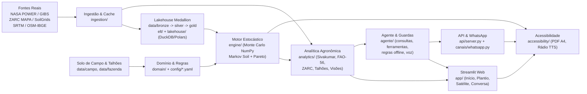

# Acauã — Motor Estocástico de Resiliência do Sertão

Sistema de apoio à decisão agrícola para **agricultura familiar do Semiárido nordestino**, técnicos de extensão rural (EMATER/cooperativas) e agentes locais, desenvolvido no contexto do desafio **"Field Shift: Adapting Farms with NASA Data"** (NASA Space Apps 2026).

> **Princípio do projeto:** o Acauã **apoia** a família agricultora e o técnico local — não decide por eles. Toda informação exibida na interface, no PDF, na API, na aba Conversa ou no WhatsApp prioriza fontes observacionais/oficiais com cache local e identifica explicitamente quando um cálculo utiliza clima ou parâmetros de exemplo.

---

## Causas e Objetivos Atendidos

### O problema no Semiárido
- **Início incerto das chuvas e falsos começos:** chuvas isoladas enganam o plantio e são seguidas por **veranicos** (dias secos consecutivos que matam a lavoura recém-germinada).
- **Secas plurianuais e ciclos climáticos:** eventos de seca prolongada (como El Niño) causam **quebras seguidas de safra**, comprometendo comida para a família e forragem para o rebanho.
- **Descompasso entre solo, cultura e manejo:** recomendações genéricas ignoram textura, profundidade do solo, exigência hídrica por cultura e diferenças entre lavoura de **sequeiro** e **irrigada**.
- **Barreiras de acesso e interpretação:** tabelas técnicas (como a tábua do ZARC), séries de satélite e estatísticas em porcentagem dificultam o uso rápido no campo.

### Objetivos do projeto
1. **Responder *"Posso plantar agora?"*** integrando chuva diária de satélite (NASA POWER), critério agronômico de chuva firme (**Sivakumar, 1988**), janelas oficiais do **ZARC (MAPA/Embrapa)** por solo e ciclo, balanço hídrico da raiz (**FAO-56 / Hargreaves**) e risco simulado de quebra de safra — diferenciando culturas de sequeiro e culturas irrigadas (**"Só com rega"**).
2. **Responder *"Qual plano rende mais estável?"*** simulando combinações de rotação de culturas em **10.000 cenários estocásticos** para minimizar a probabilidade de **2 quebras consecutivas**, equilibrando **grãos (comida), forragem, estabilidade e renda** nos talhões reais da propriedade.
3. **Democratizar a decisão com linguagem acessível e múltiplos canais:** converter probabilidades para **"X de cada 10 anos/cenários"**, oferecer navegação guiada em português simples, áudio regionalizado (**O Rádio do Tempo** / TTS), **Ficha Técnica PDF A4** para extensionistas e assistente conversacional (**Web e WhatsApp com áudio, texto e localização**).

---

## Funcionalidades Principais

### 1. Aplicação Web Interativa (`app/` — 4 páginas)
- **Início ([home_page.py](src/crop_optimizer/app/home_page.py)):**
  - Seleção entre 4 municípios de exemplo (**Petrolina/PE, Quixadá/CE, Irecê/BA e Sousa/PB**) ou ponto exato da roça marcado no mapa.
  - Perfil do solo local (**ISRIC SoilGrids + SRTM** ou **análise de campo** informada pelo usuário) com aptidão para **24 culturas** em 6 grupos (grãos e leguminosas, raízes/tubérculos, forrageiras, hortaliças folhosas/tempero, hortaliças de alto valor e frutas).
  - Cadastro de **Fazenda e Talhões** (área total, áreas por talhão, cultura plantada hoje e data do plantio).
- **Plantio ([dashboard.py](src/crop_optimizer/app/dashboard.py)):**
  - Diagnóstico da chuva da safra atual vs. normal climatológica **1991–2020** (atraso em dias, chuva acumulada, calendário diário com marcação de veranicos).
  - **Janela Oficial do ZARC (safra 2026/2027)** com visão bienal, filtro por grupo textural de solo e ciclo de cultivar, e download sob demanda da tábua oficial.
  - Aviso agronômico por cultura (semáforo para sequeiro + gráfico de risco por atraso da chuva; **plano de rega FAO-56** para culturas irrigadas com intervalo máximo e litros/m²).
  - **Ranking das rotações (10.000 cenários):** escolha de horizonte (1, 2, 3, 5 ou 10 anos), prioridade (*Equilíbrio, Produção de grãos, Forragem, Estabilidade ou Renda*), restrições (*"precisa ter"* e *"não pode ter"*) e comparação direta contra o jeito atual de plantar da fazenda.
  - **Plano safra a safra por talhão** com calendário mensal e exportação em CSV + **Ficha Técnica PDF** (`fpdf2`).
- **Satélite ([satellite_page.py](src/crop_optimizer/app/satellite_page.py)):**
  - Mapa interativo (`folium` + geocodificação Nominatim/IBGE) para marcar a roça.
  - 5 lentes **NASA GIBS** (chuva IMERG, umidade SMAP L4, vigor MODIS NDVI, temperatura MODIS LST e relevo SRTM) e comparação regional de solo via SoilGrids WCS.
- **Conversa ([conversa_page.py](src/crop_optimizer/app/conversa_page.py)):**
  - Chatbot **Acauã** por texto ou áudio (transcrição + resposta falada), exibindo o **Resumo dos filtros escolhidos** (local, data simulada, solo/ciclo ZARC, cultura em foco, horizonte, prioridade, restrições e talhões).
  - Totalmente sincronizado com os filtros da Início e Plantio, com guardas contra alucinação numérica (`guardas.py`) e modo reserva determinístico offline (`regras.py`).

### 2. Canais Externos, Áudio e API (`api/`, `canais/`, `accessibility/`)
- **Webhook WhatsApp (Twilio):** recebe texto, notas de voz e localização GPS, processa em segundo plano e devolve resposta em texto e áudio (`.ogg` / `.mp3`).
- **O Rádio do Tempo:** geração de roteiro regionalizado e síntese de voz (WAV offline, Google TTS `gTTS` ou OpenAI TTS).
- **API HTTP Starlette (`api/server.py`):** endpoints `/health`, `/api/v1/simulate`, `/api/v1/radio-do-tempo`, `/api/v1/ficha-tecnica.pdf`, `/api/v1/whatsapp/webhook` e `/media/{name}`.

---

## Arquitetura do Projeto



### Estrutura de Módulos (`src/crop_optimizer/`)

| Camada | Pacotes / Arquivos Principais | Responsabilidade |
|---|---|---|
| **Configuração** | `config.py`, `config/*.yaml` | Parâmetros agronômicos de chuva, ZARC, água FAO-56, aptidão, culturas, lentes, colheita e conversa |
| **Ingestão** | `ingestion/` (`nasa_power.py`, `power_temperature.py`, `rain_history.py`, `zarc_tabua.py`, `gibs.py`, `soilgrids.py`, `terrain.py`, `geocode.py`) | Consumo com cache local (Bronze) de chuva/temperatura NASA POWER, tábua ZARC oficial, camadas GIBS, solo, relevo e municípios IBGE |
| **Lakehouse & ELT** | `elt/pipeline.py`, `lakehouse/catalog.py` | Camadas Medallion em Parquet (`bronze/`, `silver/`, `gold/`) consultadas via DuckDB + Polars |
| **Domínio** | `domain/` (`models.py`, `crop_registry.py`, `presets.py`, `soil_profile.py`, `roca.py`, `fazenda.py`) | Modelos Pydantic/dataclasses, registro das 24 culturas, perfil de solo, roça marcada e talhões |
| **Motor Matemático** | `engine/` (`monte_carlo.py`, `markov_soil.py`, `pareto.py`, `rain_onset.py`, `candidates.py`) | Simulação vetorizada de 10.000 cenários com AR(1), Cadeia de Markov do solo, fronteira de Pareto e geração de rotações candidatas |
| **Analítica** | `analytics/` (`rain_delay.py`, `agua.py`, `crop_advice.py`, `soil_suitability.py`, `rain_calendar.py`, `talhoes.py`, `views.py`) | Atraso da chuva (Sivakumar), balanço hídrico/plano de rega (FAO-56), semáforo, calendário de safra e planejamento por talhão |
| **Agente & Canais** | `agente/` (`consultas.py`, `ferramentas.py`, `nucleo.py`, `contexto.py`, `guardas.py`, `regras.py`, `sessao.py`, `voz.py`), `canais/whatsapp.py` | Assistente Acauã (function calling OpenAI + modo reserva por regras, voz Whisper/TTS e integração WhatsApp) |
| **Interface & Acessibilidade** | `app/` (`dashboard.py`, `home_page.py`, `satellite_page.py`, `conversa_page.py`, `components.py`), `accessibility/`, `api/server.py`, `cli.py` | Dashboard multi-página Streamlit, Ficha PDF A4, Rádio do Tempo, servidor Starlette e CLI `crop-opt` |

---

## Fontes de Dados: O que é Real vs. Provisório

| Dado | Origem | Caráter |
|---|---|---|
| Chuva diária e temperatura | NASA POWER (`PRECTOTCORR`, `T2M_MAX`, `T2M_MIN`) | **Real** (cache local em `data/bronze/nasa_power/`) |
| Normal de início da chuva e veranicos | Série real 1991–2020 pelo critério de Sivakumar (1988) | **Real** |
| Janelas oficiais de plantio | Tábua de risco ZARC (MAPA/Embrapa, safra 2026/2027) | **Real** (CSV oficial + Parquet Silver) |
| Solo e relevo do ponto | ISRIC SoilGrids 2.0 (250 m), AWS SRTM Terrain Tiles ou análise de campo | **Real** (análise de campo tem prioridade) |
| Imagens de satélite e município | NASA GIBS (IMERG, SMAP, MODIS, SRTM) e Nominatim/IBGE | **Real** |
| Preços, custos e perfis climáticos base do ELT | `domain/presets.py`, `NasaPowerClient` / `B3MarketDataSource` (modo offline) | **Referência/Exemplo** (calibrado pela chuva NASA POWER do ponto quando disponível, sempre sinalizado ao usuário) |

---

## Como Executar

```bash
# 1. Ativar ambiente virtual
source .venv/bin/activate

# 2. (Opcional) Gerar/atualizar Lakehouse Parquet (Bronze -> Silver -> Gold) e pré-baixar ZARC
python scripts/run_elt.py
crop-opt zarc

# 3. Iniciar interface web Streamlit (Início, Plantio, Satélite e Conversa)
python scripts/run_app.py
# ou: crop-opt app

# 4. Rodar benchmark DuckDB + 10.000 cenários Monte Carlo
python scripts/run_benchmark.py

# 5. Iniciar API HTTP + Webhook Twilio WhatsApp
python scripts/run_api.py
# ou apenas webhook WhatsApp para exposição via túnel:
crop-opt whatsapp --host 127.0.0.1 --port 8000

# 6. Conversar com o Acauã direto no terminal (com ou sem OpenAI)
crop-opt conversa "posso plantar milho em quixadá?" --sem-ia
```

### Testes e Qualidade de Código

```bash
# Testes completos com verificação de cobertura (mínimo exigido: 80%)
pytest --cov=crop_optimizer --cov-report=term-missing

# Verificação de estilo e lint
ruff check src tests scripts
```

---

## Documentação Complementar

- [docs/funcionamento.md](docs/funcionamento.md) — guia detalhado de regras agronômicas, fluxo Bronze/Silver/Gold e limitações conhecidas.
- [docs/referencias.md](docs/referencias.md) — referências científicas e fontes de dados.
- [docs/features/](docs/features/) — histórico técnico das entregas (atraso da chuva, lentes GIBS, perfil do local, água FAO-56, calendário de chuva, chatbot, 24 culturas e planejamento por talhões).
