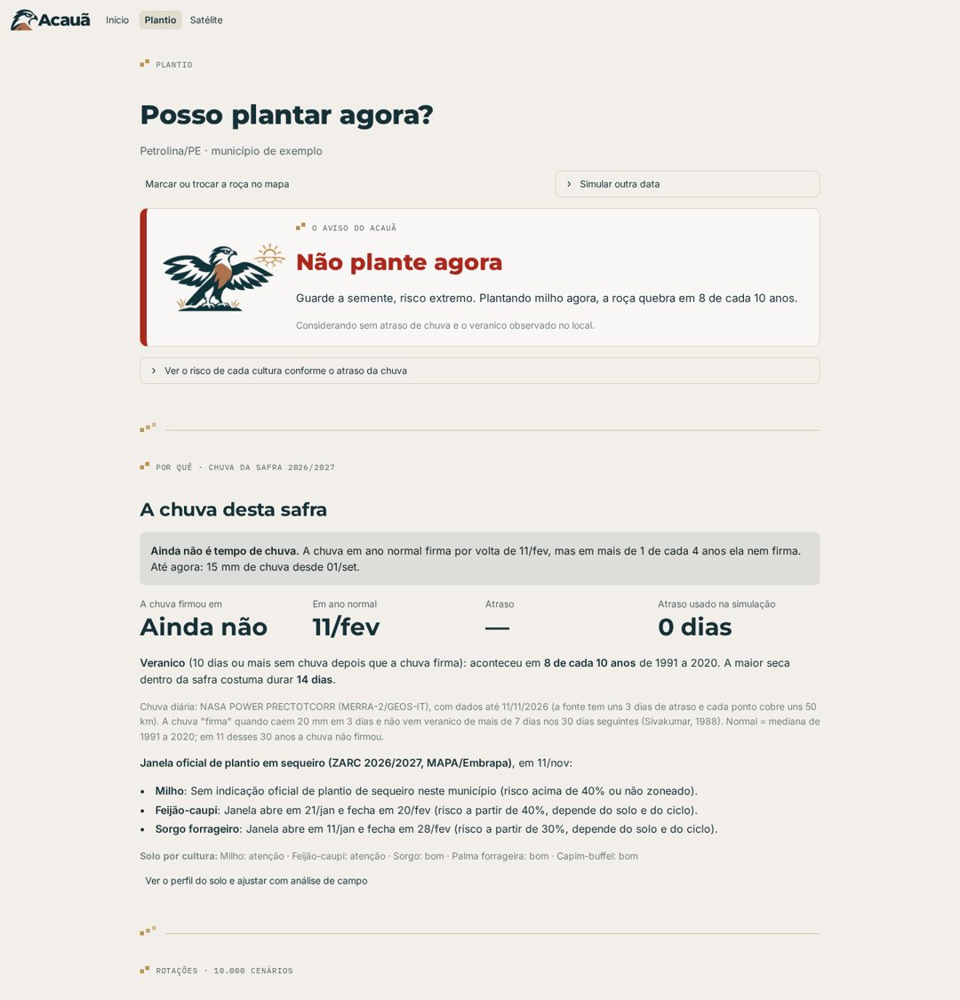
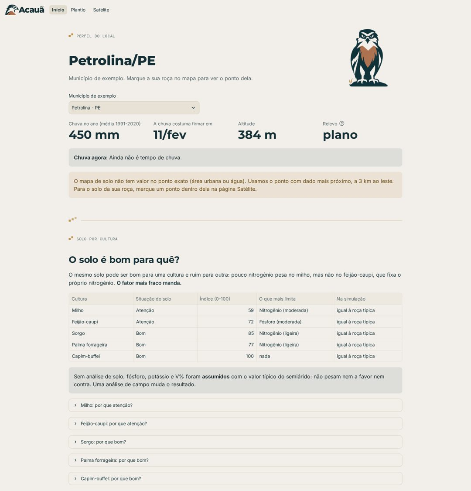
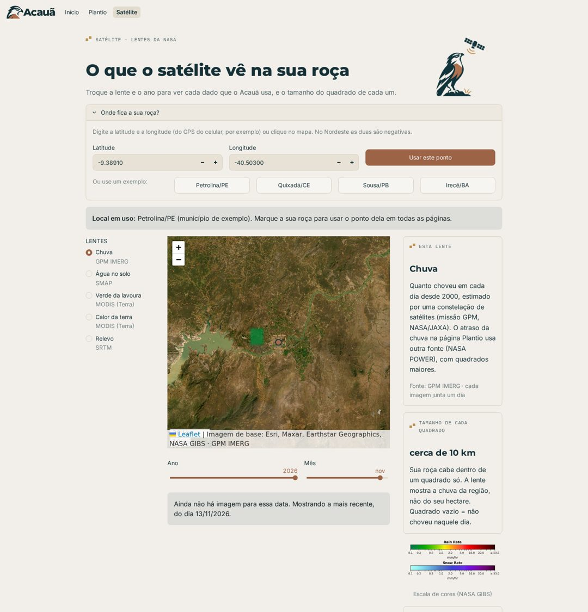
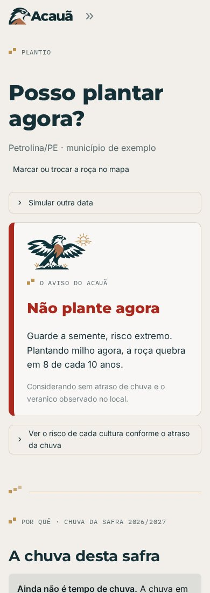

# Feature 5 — Identidade visual do Acauã

**Status:** implementada na branch `feature/identidade-visual` (a partir da `main` com as Features 1-4 e o
fix do mapa). Verificada em capturas de tela reais (computador 1440 px e celular 390 px).
**Data:** 14/11/2026



## Conceito

**Acauã** é o gavião da caatinga cujo canto, na crença popular, anuncia a seca. O app faz o mesmo: é uma
voz que avisa do risco de seca, só que olhando do espaço. Slogan das pranchas: *"O profeta da chuva que
enxerga do espaço"*.

O conceito aparece **com leveza**, em poucos rótulos:
- **"O aviso do Acauã"**: o cartão do semáforo, que é literalmente o canto que avisa.
- **Slogan no rodapé.**

O resto do texto é direto: **"Posso plantar agora?"**, **"Qual roça aguenta mais?"**, **"O solo é bom para
quê?"**.

## Como era antes

- Visual padrão do Streamlit: fundo branco, vermelho do Streamlit como cor de destaque e fonte padrão.
- Título técnico na Plantio ("Motor Estocástico de Resiliência do Sertão") e legenda com siglas
  ("NASA CHIRPS/SMAP + ZARC Embrapa em DuckDB/Parquet...", que ainda citava o CHIRPS, que não usamos).
- A resposta principal (o semáforo) aparecia **depois** dos detalhes da chuva, como um alerta comum do
  Streamlit.
- Métrica técnica de latência (ms) entre as métricas do agricultor. As métricas de risco mostravam seta
  vermelha "para cima" até com risco de 0%.
- Gráficos com as cores padrão do Tailwind (verde, azul e laranja genéricos).

## Sistema visual

### Paleta (medida nas pranchas, em `app/theme.py` e `.streamlit/config.toml`)

| Papel | Cor | Uso |
|---|---|---|
| Petróleo | `#163037` | texto, títulos, letreiro, ave |
| Creme | `#F2EFEA` | fundo (o mesmo das pranchas) |
| Areia | `#E8E2D6` | campos e blocos |
| **Terracota** | `#9C6346` | **única cor de destaque**: botões, seleção e a faixa de chamada |
| Ocre | `#BB9252` | **só** o elemento gráfico (pixel); nunca texto |
| Verde / Amarelo / Vermelho | `#266F49` / `#DDA848` / `#AA281E` | semáforo |

- A terracota da prancha (`#A46B4D`) dá 4,4:1 com texto branco, abaixo do mínimo de 4,5:1. Por isso o
  destaque usa a versão um pouco mais escura, `#9C6346` (4,9:1). A original continua nas ilustrações.
- **Contraste conferido** (todos no nível AA): texto 12,1:1; legendas 5,2:1; "Pode plantar" 5,3:1;
  "Arriscado" 5,0:1, com o amarelo escurecido para texto (`#8A5E12`); "Não plante agora" 6,0:1.
- No mapa de calor do risco, as células usam **tons claros** do semáforo com texto em petróleo, porque texto
  branco sobre o amarelo fica com 2:1.

### Tipografia (3 fontes, cada uma com uma função)

| Função | Fonte | Onde |
|---|---|---|
| Títulos | **Montserrat** 700-800 | títulos, números das métricas, palavra do aviso, abas (próxima do letreiro "Acauã") |
| Texto | **Inter** | todo o resto |
| Rótulos | **IBM Plex Mono** | só textos pequenos: rótulos de seção, fontes dos dados |

As fontes vêm do Google Fonts, pelo tema do Streamlit (`font`, `headingFont`, `codeFont` no `config.toml`).

### Elemento gráfico recorrente: o pixel

Os quadradinhos ocre em escada das pranchas. É o **único** elemento decorativo e lembra o pixel de satélite,
que é o conceito da página Satélite. Aparece em:
- **rótulos de seção:** dois quadradinhos antes do texto em mono;
- **divisores:** três quadradinhos em escada mais uma linha ocre fina;
- **mapa da Satélite:** o quadrado tracejado em volta da roça, que é um pixel de verdade, fica em ocre.

As linhas onduladas das pranchas **não** foram usadas (regra de um único elemento).

### Mascote (poses recortadas das pranchas)

| Pose | Onde |
|---|---|
| Segurando o broto | aviso **verde**: "Pode plantar" |
| Cantando (ondas) | aviso **amarelo**: "Arriscado" (o canto que avisa) |
| Asas abertas, sol e terra rachada | aviso **vermelho**: "Não plante agora" |
| Olhando o satélite | cabeçalho da página Satélite |
| De frente | cabeçalho da Início |

No celular, o mascote do cabeçalho some e o do aviso fica com 120 px, para não empurrar a resposta para
baixo.

### Animações (2, desligadas com `prefers-reduced-motion`)
1. Entrada do cartão do aviso (aparece e sobe 6 px, 420 ms).
2. Botão primário e botão da faixa de chamada sobem 1 px ao passar o mouse.

## Páginas

- **Barra do topo:** letreiro "Acauã" (sem o slogan, que fica ilegível a 32 px); ícone na aba do navegador.
  O menu de desenvolvedor do Streamlit ("Deploy") foi escondido (`client.toolbarMode = "minimal"`).
- **Plantio**, reorganizada para responder primeiro:
  1. **"Posso plantar agora?"** + cartão **"O aviso do Acauã"** com cor, palavra ("Pode plantar",
     "Arriscado", "Não plante agora", as do CLAUDE.md seção 8), mascote e frase em **"X de cada 10
     anos"** (antes era %, contra a regra do CLAUDE.md).
  2. **Por quê:** a chuva desta safra, o veranico e as janelas do ZARC. O mapa de risco por atraso fica num
     expansor logo abaixo do aviso.
  3. **"Qual roça aguenta mais?"**: horizonte, métricas (sem seta automática enganosa) e abas
     **Balança · Rádio do Tempo · Ficha para o técnico · Dados**. A latência foi para a aba Dados.
- **Início:** rótulo + nome do local como título e mascote de frente. As seções ficam separadas por
  divisores, uma com cada objetivo: solo por cultura, de onde vem cada número, janela oficial. No fim, a
  **faixa de chamada terracota**, o único bloco grande na cor de destaque: "Este perfil é do município. E a
  sua roça?", ou, com roça marcada, "Dá para plantar agora?".
- **Satélite:** cabeçalho com o mascote do satélite e rótulos da marca nos cartões da lente. Marcador da roça
  em terracota com borda petróleo.
- **Rodapé** nas três páginas: slogan + "apoia a decisão, não substitui o agricultor e o técnico" + fontes
  dos dados.
- **Gráficos:** fundo transparente, Inter/Montserrat, cores da marca e títulos em linguagem simples ("Em
  quantos de cada 10 anos a roça aguenta").

## O que foi evitado (regras do briefing)

Sem gradiente, glassmorphism ou neon; sem grade de 3 cartões com ícone, título e parágrafo; sem emojis como
ícone; sem foto de banco de imagem; sem frase-clichê; no máximo 2 animações; um bloco grande de cor só.

## Arquivos

| Arquivo | Mudança |
|---|---|
| `.streamlit/config.toml` | novo: tema (cores, fontes, cantos), menu de desenvolvedor escondido |
| `src/crop_optimizer/app/theme.py` | novo: paleta, CSS, rótulo, divisor, cabeçalho, aviso, faixa de chamada, rodapé, estilo dos gráficos |
| `src/crop_optimizer/app/assets/marca/*.png` | novo: letreiro, logo completo, ícone e 5 poses do mascote |
| `src/crop_optimizer/app/dashboard.py` | Plantio reorganizada; logo, ícone e tema no `main()` |
| `src/crop_optimizer/app/home_page.py` | cabeçalho, divisores, faixa de chamada, rodapé |
| `src/crop_optimizer/app/satellite_page.py` | cabeçalho, rótulos, cores do mapa, rodapé |
| `src/crop_optimizer/app/charts.py` | cores, fontes e títulos dos gráficos |
| `tests/test_identidade_visual.py` | 10 testes: tema = paleta, contraste AA, arquivos, CSS sem emoji e com proteção de movimento, aviso nos 3 níveis |
| `docs/features/img/05-*.jpg` | capturas de tela |

## De onde vieram as imagens

As imagens foram **recortadas das pranchas da marca enviadas pela equipe** (14/11/2026):
- logo e variações;
- poses do mascote;
- paleta;
- ícones de app.

O fundo creme foi tornado transparente com borda suave. No ícone, só a parte de fora do quadrado
arredondado ficou transparente, para o rosto da ave não sumir em fundo escuro.

- **Limitações dos recortes:** eles têm a resolução das pranchas (logo com ~800 px de largura, ícone com
  550 px). Para impressão ou tamanhos grandes, o ideal é ter o **logo em vetor (SVG)**.
- **Estilo das ilustrações:** os brancos da ave são "o papel". Por isso os recortes só funcionam sobre o
  creme. Para fundo escuro, é preciso a versão invertida das pranchas.

## Como testar

```bash
pytest tests/test_identidade_visual.py
streamlit run src/crop_optimizer/app/dashboard.py --server.port 8501
```
**Mudanças em `theme.py` exigem reiniciar o servidor:** o Streamlit só recarrega sozinho o script principal.
Mudanças em `.streamlit/config.toml` também exigem reinício.

| Início | Satélite | Plantio no celular |
|---|---|---|
|  |  |  |

## Pendências

- [ ] Logo em vetor (SVG) para nitidez em tela grande e impressão.
- [ ] Ficha PDF e mensagem de WhatsApp ainda sem a identidade visual (fontes e cores).
- [ ] O slogan "O profeta da chuva" pede validação com agricultores: na crença popular o canto do acauã
  anuncia **seca**, e o produto avisa dos dois lados (chuva boa e seca).
