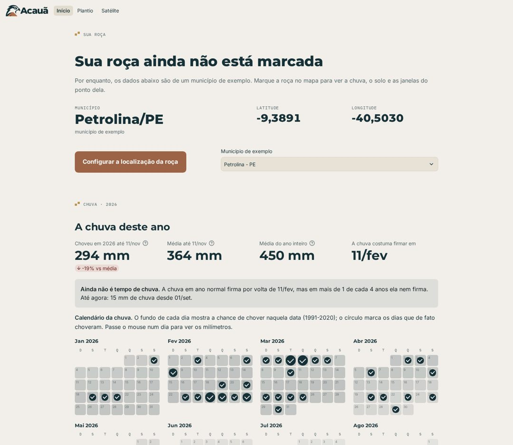
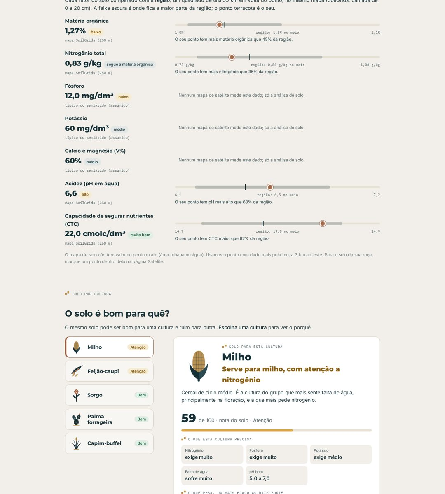
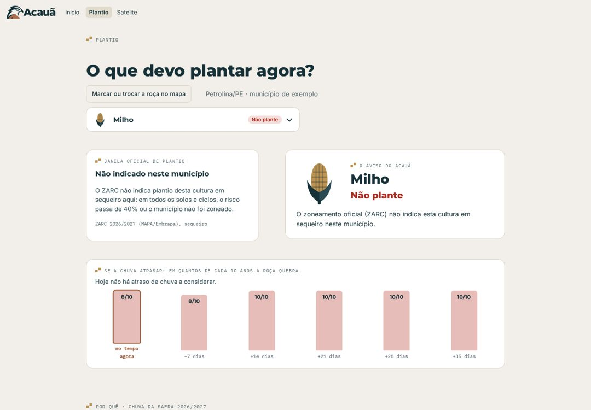
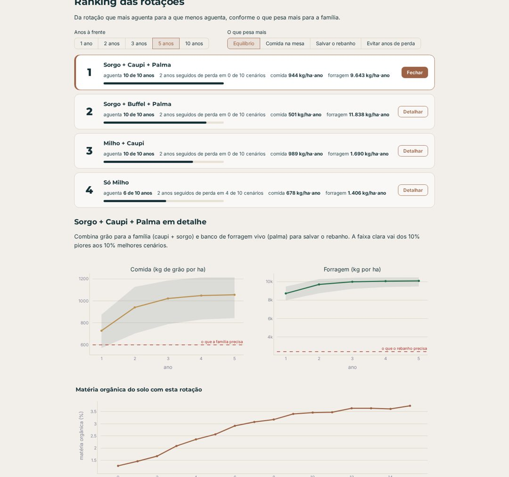
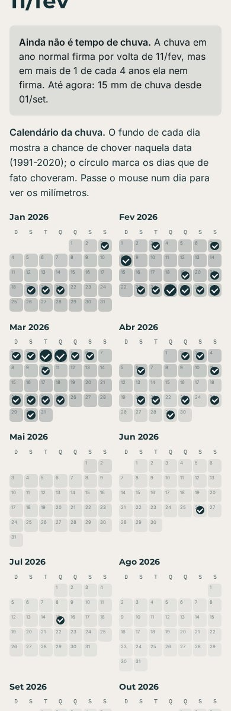

# Feature 6 — Páginas Início e Plantio interativas

**Status:** implementada na branch `feature/paginas-interativas` (a partir da `main` com as Features 1-5).
Verificada com capturas de tela e cliques reais em navegador (computador e celular).
**Data:** 14/11/2026

## Pedidos atendidos

| Pedido | Como ficou |
|---|---|
| Sem traços separando seções | Os divisores viraram só espaço em branco. O "pixel" continua só nos rótulos. |
| Seção "Sua roça" dedicada | Município, latitude e longitude em números grandes. Sem roça: botão terracota **"Configurar a localização da roça"** (vai para o mapa). Com roça: **"Editar local"**, discreto. |
| Chuva do ano atual x média | "Choveu em 2026 até 11/nov: 294 mm", com **seta verde para cima ou vermelha para baixo** e a % em relação à média de 1991-2020 **do mesmo período** (1º/jan até a mesma data). Mais a média até a data, a média do ano e quando a chuva costuma firmar. |
| Calendário de chuva | 12 meses do ano. O fundo de cada dia é a **marca d'água** com a chance histórica de chover naquela data. O **círculo com check** marca os dias que choveram (maior = mais chuva). Também mostra o início da chuva (verde), o início normal (tracejado), os veranicos (traço vermelho embaixo) e hoje. Passe o mouse num dia para ver os mm. |
| Solo por cultura interativo | Coluna esquerda: **cards** com ícone, nome e situação. Clicar põe a cultura em **destaque** à direita: ícone grande, descrição, nota do solo (0-100), veredito ("O solo é bom para sorgo" / "Serve para milho, com atenção a nitrogênio"...), o que a cultura precisa e cada fator do mais fraco ao mais forte. |
| Seção sobre o solo do lugar, comparado com a região | **"Como é o solo daqui"**: matéria orgânica, nitrogênio, fósforo, potássio, cálcio e magnésio, pH e CTC. Cada um mostra valor, classe oficial, de onde veio e uma **régua da região**: um quadrado de ~55 km, com a faixa onde fica a maior parte da região, a mediana e o seu ponto. Exemplo: "O seu ponto tem mais matéria orgânica que 45% da região". |
| Solo e relevo sem tabela, com classificação do terreno | **"O terreno"**: tipo de terreno ("Plano, textura franco-argiloarenosa") pelas classificações que já existem (triângulo textural SBCS/USDA e classes de relevo da Embrapa). Mais os cartões de areia/silte/argila (barra), relevo (escala), água que o solo segura e altitude. |
| Janela do plantio na página Plantio | Saiu da Início e foi para a Plantio, por cultura. |
| Título "O que devo plantar agora?" | Feito. O botão "Marcar ou trocar a roça no mapa" fica **na frente** da localização. |
| Seletor de culturas com ícones | **Seletor próprio** (combobox) com ícone, nome e o aviso de cada cultura. Esquerda: **janela oficial do ZARC** do ano em decêndios (cores por risco de 20/30/40% e marcador de hoje). Direita: **ícone grande + nome + aviso** (Pode plantar / Arriscado / Não plante / Espere...). Embaixo: **risco por atraso só da cultura escolhida**, em barras "X/10" com o atraso de hoje marcado. |
| "Por quê" com calendário e sem termos relativos | O calendário da safra mostra quando a chuva firmou, os veranicos e o início normal. Os padrões do local vêm em texto ("Veranico de 10 dias ou mais em 8 de cada 10 anos; a maior seca costuma durar 14 dias"). "Caiu chuva boa em..." virou **"A chuva atingiu o critério de início em..."**, com o critério escrito (20 mm em 3 dias, sem veranico de mais de 7 dias nos 30 seguintes). |
| "Qual roça aguenta mais?" | Virou **"Ranking das rotações"**, com horizonte de **1, 2, 3, 5 e 10 anos** e "O que pesa mais" (equilíbrio, comida, rebanho, evitar perda). O ranking **muda com a seleção**. Cada linha mostra quantos anos aguenta, o risco em "X de 10 cenários", a comida e a forragem. **"Detalhar"** abre a comida e a forragem por ano (com a faixa dos cenários e o que a família e o rebanho precisam) e a matéria orgânica do solo. |
| Tirar Rádio do Tempo e Dados | Saíram da página. O código continua no projeto. |
| "Ficha técnica" como seção | Seção própria: PDF, limites do modelo e gráficos técnicos. |
| "Simular outra data" no rodapé | Fica no rodapé da Plantio, como opção de teste. |

### Aviso por cultura ("O que devo plantar agora?")
`analytics/crop_advice.py` decide nesta ordem, usando só o que já tem fonte:
1. **ZARC não indica a cultura no município:** "Não plante".
2. **A chuva não firmou** (antes da época ou atrasada): "Espere a chuva firmar".
3. **A janela do ZARC ainda não abriu:** "Espere a janela abrir (data)". **Já fechou:** "Fora da janela".
4. **Janela aberta:** semáforo pelo risco com o atraso de hoje. "Pode plantar", "Arriscado" ou "Não plante agora", com "a roça quebra em X de cada 10 anos".

Palma e capim-buffel não têm janela anual no ZARC (são perenes), então usam só o risco.

## Como foi feito

- **Componentes próprios** (`app/components.py`) com `st.components.v2`: HTML, CSS e JS sem etapa de build, que devolvem o clique ao Python. São 9: cards de cultura, card de destaque, seletor, calendário, régua da região, janela do ZARC, risco por atraso, ranking e terreno.
  - Todo texto vindo de dados é escapado no JS.
  - O estilo é isolado (shadow DOM), com a paleta e as fontes da marca.
  - O valor escolhido é lido da sessão **antes** de desenhar, para o componente não mostrar a escolha antiga na execução disparada pelo próprio clique.
- **A cultura escolhida vale nas duas páginas.** Escolher sorgo na Início abre o sorgo na Plantio, e vice-versa.
- **Ícones das culturas** (`app/icons.py`): 5 SVG desenhados para o projeto, no estilo do mascote (petróleo, terracota e ocre). Nenhum crédito do Higgsfield foi usado.
- **Solo da região** (`ingestion/soilgrids_wcs.py`):
  - **Por que não a API REST:** ela tem limite de 5 chamadas por minuto.
  - **O que usamos:** o serviço de mapas WCS do ISRIC, que devolve o recorte da região inteira numa chamada por camada (~1 s).
  - **Cálculo:** 6 atributos x 3 profundidades, com a mesma média de 0-20 cm do ponto. O pixel sem dado (cidade ou água) fica de fora.
  - **Cache:** `data/bronze/soilgrids_wcs/`.
- **Calendário e chuva do ano** (`analytics/rain_calendar.py`):
  - chance de chover por dia = fração dos anos 1991-2020 com chuva de 1 mm ou mais, numa janela de 15 dias em volta da data;
  - veranicos = sequências de 10 dias ou mais sem chuva depois do início.
- **Classe textural** (`analytics/soil_texture.py`): regras do triângulo textural USDA, com os nomes da SBCS.
- **Ranking** (`engine/pareto.py`): `rank_by_balance_priority`, com os mesmos pesos da antiga Balança.

### Arquivos

| Arquivo | Mudança |
|---|---|
| `src/crop_optimizer/app/components.py` | novo: 9 componentes |
| `src/crop_optimizer/app/icons.py` | novo: ícones SVG das 5 culturas |
| `src/crop_optimizer/analytics/rain_calendar.py` | novo: chuva do ano, chance por dia, veranicos, meses do calendário |
| `src/crop_optimizer/analytics/soil_texture.py` | novo: triângulo textural |
| `src/crop_optimizer/analytics/crop_advice.py` | novo: aviso por cultura |
| `src/crop_optimizer/ingestion/soilgrids_wcs.py` | novo: solo da região (WCS) |
| `src/crop_optimizer/app/home_page.py` | Início reescrita |
| `src/crop_optimizer/app/dashboard.py` | Plantio reescrita (sem Rádio e Dados) |
| `src/crop_optimizer/app/charts.py` | gráficos do detalhe da rotação |
| `src/crop_optimizer/app/common.py` | cache da região, da chance de chuva e do ZARC por decêndio |
| `src/crop_optimizer/app/theme.py` | sem divisores com traço; estilos da seção "Sua roça" |
| `src/crop_optimizer/engine/pareto.py` | ranking pela prioridade |
| `src/crop_optimizer/analytics/rain_delay.py` | texto objetivo para o início da chuva |
| `config/aptidao.yaml` | descrição curta de cada cultura (REVISAR AGRÔNOMO) |
| `tests/test_paginas_interativas.py` | 17 testes novos |

## Telas

| Início: roça e chuva | Início: solo |
|---|---|
|  |  |

| Plantio: o que plantar | Plantio: ranking e detalhe | Calendário no celular |
|---|---|---|
|  |  |  |

## Limitações

- **Régua da região:** só para matéria orgânica, nitrogênio, pH e CTC. Fósforo, potássio e V% não estão em nenhum mapa, só na análise de solo.
- **A "região" é um quadrado fixo de ~55 km,** não o município nem a bacia.
- **O calendário usa a chuva do NASA POWER (~50 km).** O dia "com chuva" é o do pixel, não o da roça.
- **Os textos das culturas e as exigências** seguem marcados para revisão de agrônomo.
- **Os 404 no console ao abrir `/plantio` direto** são do próprio Streamlit (ele tenta `/plantio/_stcore/health` antes do endereço certo) e não afetam nada.
