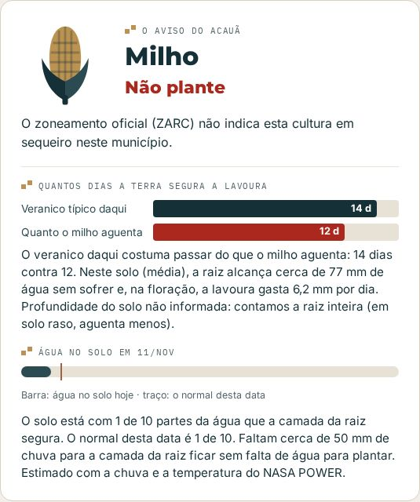
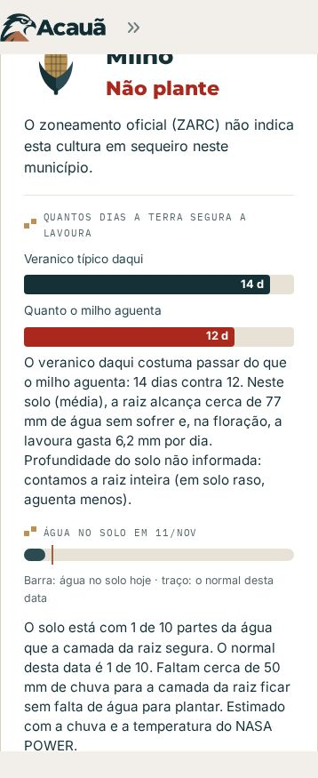
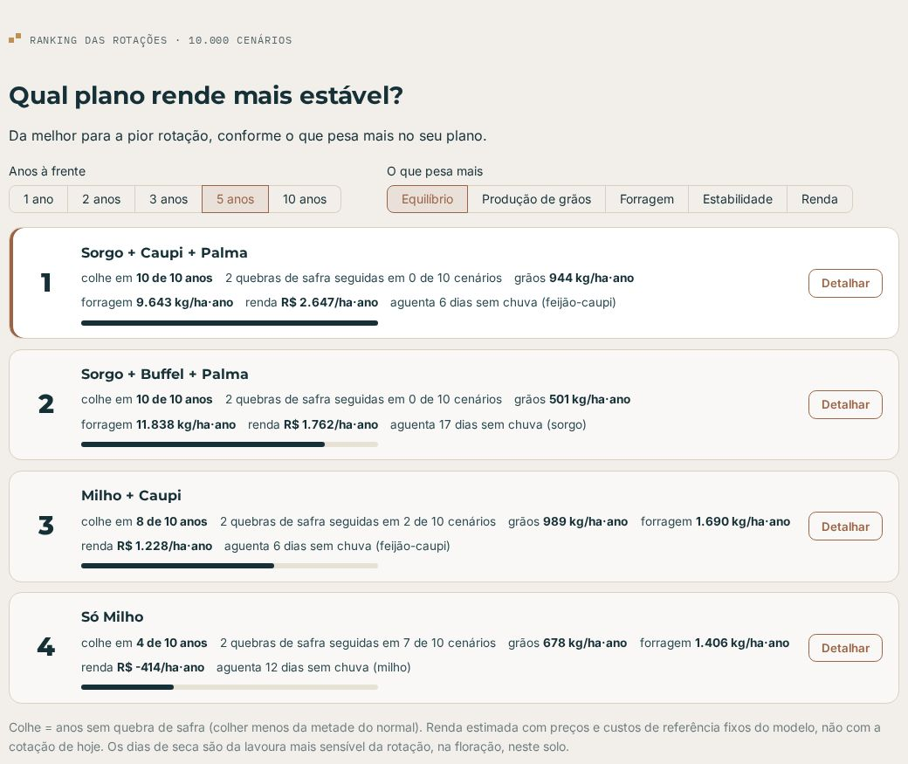
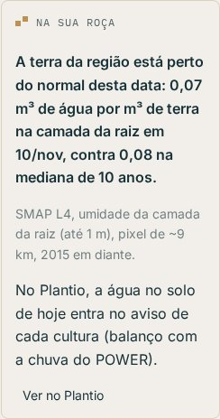
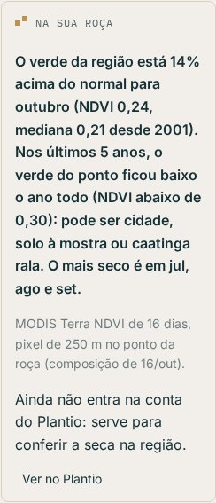

# Feature 7 — Água da roça, frase de cada lente e prioridades de produtor

**Status:** implementada na branch `feature/agua-e-insights` (a partir da `fix/aviso-mesmo-motor`).
Verificada com capturas de tela e cliques reais em navegador.
**Data:** 15/11/2026

## Antes e depois

| Antes | Agora |
|---|---|
| O aviso dizia "não plante" sem mostrar o porquê em termos que o produtor confere no campo. | O aviso mostra **quantos dias a terra segura a lavoura** neste solo, ao lado do **veranico típico daqui**, em duas barras na mesma escala de dias. |
| Nada dizia quanto de água o solo tem hoje. | Linha **"Água no solo em dd/mmm"**: X de 10 partes da água que a camada da raiz segura, o normal desta data e quantos mm de chuva faltam para plantar. |
| As lentes da Satélite mostravam a imagem e explicavam o dado, mas não diziam nada sobre a roça. | Cada lente termina com **"Na sua roça"**: uma frase com o número do ponto e o lugar do app onde ele é usado, com link. |
| Prioridades: "Comida na mesa", "Salvar o rebanho", "Evitar anos de perda". | **Produção de grãos, Forragem, Estabilidade, Renda** (nova) e Equilíbrio. Título: **"Qual plano rende mais estável?"** |
| "Placar de sobrevivência", "perde a roça", "aguenta 6 de 10 anos". | **"Colhe em X de 10 anos"** e **"quebra de safra"**, também na ficha em PDF. |

## Peça 1: quantos dias a terra segura a lavoura

**Conta (FAO-56, turno de rega):**
- **dias = RAW / ETc** na fase média (floração e enchimento de grão);
- TAW = CAD x Zr, a água que o solo segura ao alcance da raiz;
- RAW = p x TAW, a parte que a planta tira sem sofrer;
- ETc = Kc da fase média x ET0.

**ET0:** Hargreaves (FAO-56 eq. 52), com a temperatura máxima e mínima do NASA POWER e a Ra pela latitude e
dia do ano (eq. 21). A ET0 usada é a **mediana da floração** em 1991-2020, com plantio no dia em que a chuva
firmou em cada ano (critério de Sivakumar, o mesmo da página).

**CAD:** vem da textura do solo (`config/aptidao.yaml`). Zr, p e Kc vêm de `config/agua.yaml` (FAO-56,
`# CONFERIR`).

**Palma:** é planta CAM e guarda água na raquete, então a conta não vale para ela. O aviso diz isso em vez de
mostrar um número.

**Profundidade do solo:** é o que mais limita a água no Sertão, e nenhum mapa aberto a entrega sem
pacote novo. O MapBiomas Solo exigiria ler GeoTIFF com `rasterio`, e o endereço público testado
devolveu 403. Por isso ela virou um **campo opcional na análise de campo** (Início). Sem ela, contamos a
raiz inteira, e o aviso diz isso.

**Exemplo (Petrolina, ponto do município, textura média):**

| | Dias |
|---|---|
| Veranico típico | 14 |
| Milho | 12 |
| Sorgo | 17 |
| Feijão-caupi | 6 |
| Capim-buffel | 22 |

Em solo arenoso, o milho aguenta 6 dias e o sorgo 8.

**Onde aparece:**
- no aviso de cada cultura;
- no ranking, como "aguenta X dias sem chuva (cultura mais sensível da rotação)".

## Água no solo hoje

**Balanço:** diário, de um reservatório (FAO-56), com o **solo nu** (Kc 0,3). Usa a chuva e a ET0 do NASA
POWER e roda sem parar desde 1981.

**O que a tela mostra:**
- a fração da água que a camada da raiz da cultura segura hoje;
- a mediana de 1991-2020 na mesma data;
- **quantos mm faltam** para a depleção cair até a RAW da cultura, o ponto em que a raiz fica sem falta
  de água.

Isso é estimativa de modelo, e a tela diz isso. O número medido por satélite (SMAP) está na lente "Água no
solo".

## Satélite: uma frase por lente

| Lente | Frase (exemplo real, Petrolina, 15/11/2026) | Dado | Onde é usado |
|---|---|---|---|
| Chuva | "Este ano está perto do normal: o 11º mais seco dos últimos 26." | NASA POWER (a chuva do motor) | Plantio |
| Água no solo | "A terra da região está perto do normal desta data: 0,07 m³/m³ na camada da raiz, contra 0,08 na mediana de 10 anos." | SMAP L4, camada da raiz | Plantio (o aviso usa o balanço com o POWER) |
| Verde | "O verde da região está 14% acima do normal para outubro (NDVI 0,24, mediana 0,21 desde 2001)" + os meses mais secos | MODIS NDVI 16 dias | ainda não entra na conta; serve para conferir a seca |
| Calor | "Em 0 de cada 10 anos, o chão passa de 40 °C na época da floração do milho." | MODIS LST de dia, 8 dias | alerta extra, ainda fora do motor |
| Relevo | "2% de declividade: relevo plano. Risco de enxurrada baixo, mas pode empoçar." | SRTM (Terrain Tiles) | Início, fator erosão |

**Como o número sai do GIBS** (`ingestion/gibs_values.py`):
1. O GIBS só entrega imagem colorida. Pedimos um recorte de 9x9 pixels em volta do ponto (WMS, EPSG:4326).
2. Lemos a cor do pixel do meio.
3. Traduzimos a cor pela **legenda oficial** da camada (colormap XML do GIBS), que publica a faixa de valor
   de cada cor. A precisão é a da faixa: 0,003 m³/m³ no SMAP e ~0,007 no NDVI.

São cerca de 1 s por consulta. A API de recortes da ORNL DAAC dá o número exato, mas levou ~50 s por
consulta.

**Cache:**
- `data/bronze/gibs_colormaps/` e `data/bronze/gibs_pixels/<camada>/`;
- imagens dos últimos 30 dias que vierem vazias não entram no cache.

**Não entrou:**
- **Anos de uso sem descanso (MapBiomas):** o MapBiomas classifica a aparência do pixel ano a ano. Um
  pousio curto continua parecendo pasto, então o número não se sustenta.
- **Carbono do solo (MapBiomas Solo) como sexta lente:** os arquivos não estão abertos sem login (403/401
  no bucket público) e ler GeoTIFF pede `rasterio`, que não está na lista de dependências.

## Prioridades de produtor

| Antes | Agora |
|---|---|
| Comida na mesa | Produção de grãos |
| Salvar o rebanho | Forragem |
| Evitar anos de perda | Estabilidade (colher todo ano) |
| — | **Renda** (nova) |
| Placar de sobrevivência | Anos de colheita ("colhe em X de 10 anos") |
| Perde a roça | Quebra de safra |
| Qual roça aguenta mais? | Qual plano rende mais estável? |

**Como a Renda pesa:**
- é a renda líquida média por ano (R$/ha) que o motor já calculava;
- vira nota de 0 a 100 entre as rotações comparadas;
- pesos (grãos, forragem, estabilidade, renda): 0,25 cada no Equilíbrio, 0,55 na prioridade escolhida.

**Atenção:** os preços e custos são **valores fixos do modelo** (`domain/presets.py`), não cotação. A tela
avisa isso. Para valer de verdade, falta ligar preços da CONAB.

## Arquivos

| Arquivo | Mudança |
|---|---|
| `config/agua.yaml` | novo: Kc, Zr, p e fases por cultura; balanço do solo nu; limiares das lentes |
| `src/crop_optimizer/analytics/agua.py` | novo: Ra, ET0, dias que aguenta, balanço do solo nu |
| `src/crop_optimizer/ingestion/power_temperature.py` | novo: T2M_MAX/T2M_MIN do NASA POWER com cache |
| `src/crop_optimizer/ingestion/gibs_values.py` | novo: valor da camada no ponto pela legenda |
| `src/crop_optimizer/analytics/lens_insights.py` | novo: frase de cada lente |
| `config/lentes.yaml` | texto do risco de enxurrada por classe de relevo |
| `src/crop_optimizer/app/dashboard.py` | bloco de água no aviso, ranking com grãos, renda e dias de seca, prioridades novas |
| `src/crop_optimizer/app/components.py` | barras de dias e reservatório no aviso; chips novos no ranking |
| `src/crop_optimizer/app/satellite_page.py` | cartão "Na sua roça" em cada lente |
| `src/crop_optimizer/app/home_page.py` | profundidade do solo na análise de campo |
| `src/crop_optimizer/domain/soil_profile.py` | profundidade informada no perfil |
| `src/crop_optimizer/engine/pareto.py`, `domain/models.py` | prioridade Renda |
| `charts.py`, `views.py`, `presets.py`, `one_pager_pdf.py`, `whatsapp.py` | nomes de produtor |
| `tests/test_agua_e_lentes.py` | 12 testes novos (Ra do exemplo 8 da FAO-56, ET0, dias, balanço, legenda, frases, Renda, texto do aviso) |

## Telas

| Aviso com a água da roça | No celular |
|---|---|
|  |  |

| Ranking | Lente Água no solo | Lente Verde |
|---|---|---|
|  |  |  |

## Limitações

- **Kc, Zr e p** são os valores de tabela da FAO-56, não calibrados para o semiárido (`# CONFERIR`). O
  feijão-caupi sai com poucos dias porque a raiz dele é rasa na tabela. A tolerância à seca que vem da
  fisiologia da planta não entra na conta.
- **Sem a profundidade do solo**, os dias podem estar superestimados em solo raso.
- **A água no solo hoje é do pixel do NASA POWER (~50 km)**, com solo nu e sem escoamento.
- **SMAP (~9 km), NDVI (250 m) e LST (1 km)** mostram a região, não o canteiro. Se o ponto cai na cidade, o
  NDVI fica baixo o ano todo, e a frase avisa.
- **A renda usa preços fixos do modelo.**
