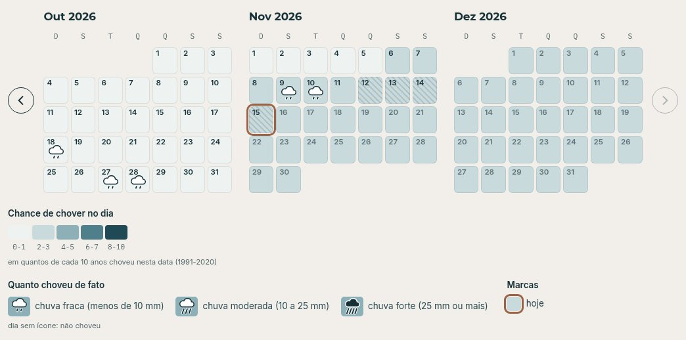
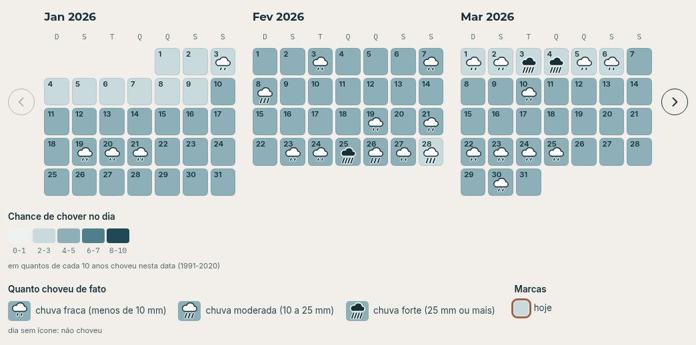
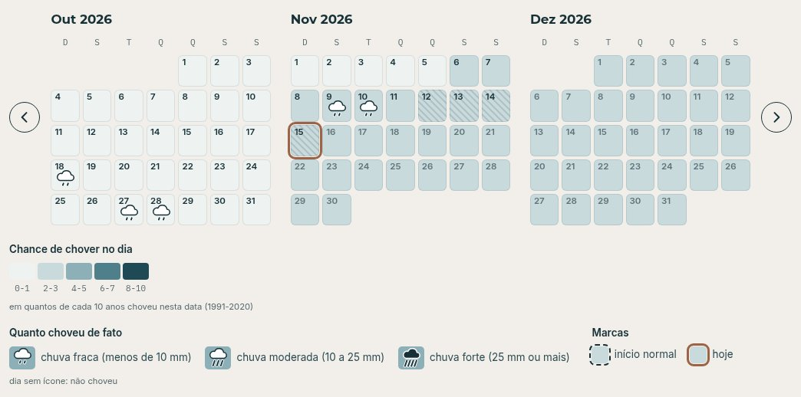
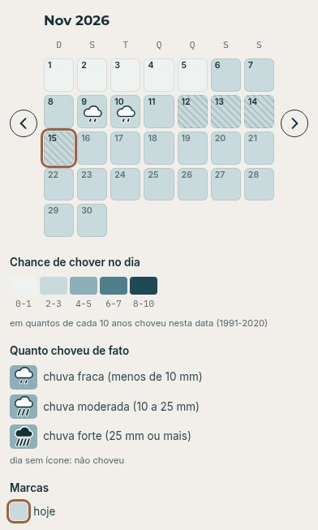

# Feature 8 — Calendário de chuva legível

**Status:** implementada na branch `feature/calendario-chuva` (a partir da `main` com as Features 1-7).
Verificada com capturas de tela e cliques reais em navegador (computador e celular).
**Data:** 15/11/2026

## Antes e depois

| Antes | Agora |
|---|---|
| 12 meses (Início) ou 9 meses (Plantio) de uma vez, com quadradinhos pequenos. | **3 meses por vez**, com quadradinhos maiores e **setas à esquerda e à direita** para navegar. No celular, 1 mês por vez. |
| O círculo com check cobria o número do dia. | O número fica **em cima** e o ícone **embaixo**, sem se sobrepor. |
| A chance de chover era um cinza contínuo e fraco (difícil de comparar dias). | **5 faixas de cor bem distintas**, do claro ao petróleo escuro: 0-1, 2-3, 4-5, 6-7 e 8-10 de cada 10 anos. Nas faixas escuras o número fica branco. |
| Check maior ou menor para dizer quanto choveu. | **Ícones de previsão do tempo:** chuva fraca, moderada e forte. |
| Legenda em uma linha só. | Legenda em três blocos: **chance de chover no dia**, **quanto choveu de fato** e **marcas** (veranico, a chuva firmou, início normal, hoje). |

Agora dá para ler sem esforço "estava previsto chover e choveu": um dia escuro com ícone choveu como
esperado; um dia escuro **sem** ícone devia ter chovido e não choveu.

## Navegação

- O calendário abre com o **mês de hoje no meio** (o anterior à esquerda, o próximo à direita). Se hoje não
  está no período, abre no último mês com dado observado.
- As setas avançam ou voltam 3 meses e ficam apagadas no começo e no fim do período.
- A navegação roda **no navegador**: trocar de mês não recarrega a página nem refaz as contas.
- Abaixo de 560 px de largura o calendário mostra 1 mês por vez e as setas andam 1 mês.

## Ícones de chuva

| Ícone | Quando | Desenho |
|---|---|---|
| Chuva fraca | menos de 10 mm no dia | nuvem clara com 2 pingos curtos |
| Chuva moderada | 10 a 25 mm | nuvem clara com 3 riscos |
| Chuva forte | 25 mm ou mais | nuvem escura com 4 riscos longos |

- Dia com menos de 1 mm (o `dia_chuvoso_mm` do critério de início) conta como seco e fica sem ícone.
- Os ícones são SVG desenhados no próprio componente, com contorno branco para aparecer em qualquer faixa de
  cor do fundo.
- Os limites de 10 e 25 mm estão em `config/chuva.yaml` (`calendario.chuva_moderada_mm` e
  `calendario.chuva_forte_mm`, `# CONFERIR`). Antes ficavam fixos no JS.
- Passe o mouse num dia para ver os milímetros e o nome da chuva ("choveu 18 mm (chuva moderada)").

## Faixas de chance

A chance continua a mesma conta da Feature 6 (fração dos anos 1991-2020 com chuva de 1 mm ou mais numa janela
de 15 dias em volta da data). Só a cor mudou: em vez de uma transparência contínua, o número "X de cada 10" é
arredondado e cai numa de 5 faixas. Faixas discretas são mais fáceis de comparar de relance do que um degradê.

## Arquivos

| Arquivo | Mudança |
|---|---|
| `src/crop_optimizer/app/components.py` | calendário reescrito: paginação de 3 meses com setas, faixas de cor, ícones de chuva, legenda em blocos |
| `src/crop_optimizer/app/home_page.py` | texto acima do calendário explica a cor, os ícones e as setas |
| `config/chuva.yaml` | novo bloco `calendario` com os limites de chuva moderada e forte |

O formato dos dados (`analytics/rain_calendar.py::calendar_months`) não mudou, então o calendário da Início e o
da Plantio pegaram a mudança sem alterar quem os chama.

## Telas

| Início: mês de hoje no meio | Início: estação chuvosa (jan-mar) |
|---|---|
|  |  |

| Plantio: calendário da safra | No celular |
|---|---|
|  |  |

## Limitações

- **Os limites de 10 e 25 mm** são uma convenção usual para chuva diária, não calibrada para o semiárido
  (`# CONFERIR`).
- **A chuva do dia é do pixel do NASA POWER (~50 km).** Um ícone de chuva forte quer dizer que choveu forte na
  região, não necessariamente na roça.
- **O mês aberto não é guardado entre páginas:** ao voltar para a Início, o calendário abre de novo no mês de
  hoje.
