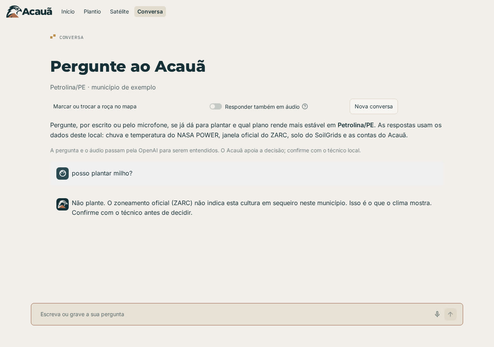
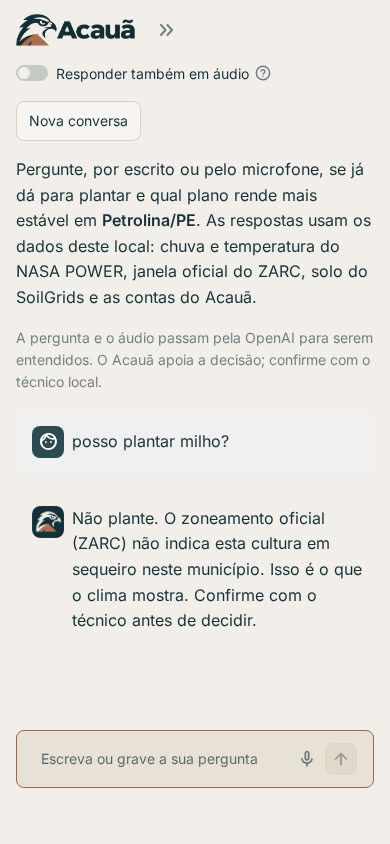

# Feature 8 — Chatbot do Acauã (OpenAI, texto e áudio)

**Status:** implementada na branch `feature/whatsapp-audio` (a partir da `main` com as Features 1-7). Testada com a
OpenAI de verdade na página Conversa (texto) e no terminal (texto e áudio). A gravação pelo microfone do
navegador não tem teste automático (o navegador de teste não tem microfone): conferir à mão.
**Data:** 15/11/2026

## Objetivo

Uma conversa com o Acauã, por **texto ou áudio**, que responde com os dados do **local selecionado no app**:

1. **"O que planto hoje?"** Uma **ação recomendada** (o que fazer hoje e com qual cultura), para grãos e para o
   rebanho, ou só para o que a pessoa pediu; com o porquê, uma alternativa e o que evitar.
2. **"Posso plantar milho?"** O mesmo aviso por cultura da página Plantio (ZARC, chuva da safra, janela, risco
   e água da roça), com o motivo.
3. **"Qual plano rende mais estável?"** O mesmo ranking das rotações da página, conforme o que pesa mais
   (grãos, forragem, estabilidade, renda ou equilíbrio).
4. **Perguntas sobre o próprio app:** de onde vêm os dados, o que é real e o que é exemplo, o que o modelo não vê.

### Mudança de rumo
A feature começou como **WhatsApp pelo Twilio**. O canal ficou pronto e testado, mas a conta gratuita do Twilio
não deixa configurar o webhook (por onde as mensagens chegam ao Acauã), e as outras opções gratuitas tinham
limites que não serviam (a 360dialog aceita só 25 mensagens e não recebe áudio). A equipe decidiu:

1. **Agora:** o chatbot dentro do app (página **Conversa**), com a OpenAI e opção de áudio.
2. **Segunda etapa:** levar o mesmo chatbot ao **Telegram**.

O código do WhatsApp continua no projeto (`canais/whatsapp.py`, comando `crop-opt whatsapp`), com testes, mas sem
uso por enquanto. O agente não depende do canal: o app, o terminal, o WhatsApp e o Telegram chamam a mesma função.

---

## O que o chatbot recebe antes da pergunta

| Ordem | O quê | Onde | Muda? |
|---|---|---|---|
| 1 | **Prompt inicial:** o que é o Acauã, para que serve, que dados coleta (e quais são reais ou de exemplo), o que ele não vê e como deve responder | `agente/prompt.py` | fixo (fica em cache na OpenAI) |
| 2 | A data de hoje (e a data simulada do demo) | `agente/prompt.py` → `date_note` | por dia |
| 3 | **Dados do local selecionado:** aviso de cada cultura com chuva, janela oficial e água; ranking das rotações no padrão da página (5 anos, equilíbrio); solo | `agente/contexto.py` | por local e data |
| 4 | As últimas 8 mensagens da conversa | `agente/sessao.py` | a cada mensagem |
| 5 | A pergunta (texto ou o áudio já transcrito) | | |

Os dados do item 3 são **calculados pelas mesmas ferramentas** que o modelo pode chamar, e elas dão **os mesmos
números da página Plantio** (um teste roda a página e compara). Com eles, a maioria das perguntas é respondida sem
chamar nenhuma ferramenta. Para outra cultura, outro horizonte, outra prioridade ou outra data, o modelo chama a
ferramenta.

```
 Página Conversa (ou terminal)
   local e data do app ──► contexto.py ──► situacao_plantio + placar_rotacoes + solo_da_roca (mesmas contas da Plantio)
   pergunta (texto | microfone ──► transcrição OpenAI)
        │
        ▼
 OpenAI (gpt-5-nano) com: prompt inicial + data + dados do local + histórico + pergunta + 4 ferramentas
        │   (chama ferramentas só quando precisa de outra conta)
        ▼
 guardas.py: sem %, só números dos dados, aviso não suavizado, "firmou" só quando firmou ──► se falhar: reescreve
        │                                                                                  ──► se falhar de novo: regras
        ▼
 resposta em texto (+ áudio mp3 pelo gTTS, grátis, quando a pergunta foi por áudio ou o botão está ligado)
```

### As ferramentas (`agente/ferramentas.py`)

| Ferramenta | O que devolve | Dado |
|---|---|---|
| `situacao_plantio` | por cultura: para que serve (grãos, forragem), aviso (palavra, nível, motivo), quebra de safra com o atraso de hoje, janela do ZARC, água (dias que aguenta sem chuva na floração, veranico típico, água no solo hoje); chuva da safra; sem cultura, a **recomendação do dia** (abaixo). Aceita `finalidade` (grãos ou forragem) | chuva, ZARC e água **reais**; risco com **clima de exemplo** |
| `placar_rotacoes` | ranking das rotações pela prioridade (grãos, forragem, estabilidade, renda, equilíbrio) e horizonte (1 a 10 anos): colhe em X de 10 anos, quebra de safra, grãos, forragem, renda, jeito de hoje | **clima de exemplo** (sempre avisado) |
| `solo_da_roca` | o que mais limita cada cultura no solo do local | real (SoilGrids, SRTM) ou análise de campo |
| `definir_roca` | guarda o município de exemplo ou o ponto (para o terminal e os mensageiros; no app o local vem da tela) | real (OpenStreetMap + IBGE) |

Toda chance sai como **"X de cada 10"** (até o risco oficial do ZARC, 20%, vira "até 2 de cada 10 anos") e o que
usa clima sintético sai com `dados_de_exemplo: true`. O modelo só repassa esses números.

### "O que planto hoje?": a recomendação do dia (`agente/recomendacao.py`)

No primeiro teste, a pergunta "o que devo plantar hoje?" recebia a lista de todas as culturas com "a chuva ainda
não firmou". Agora o código entrega ao chatbot uma **ordem já calculada**, com critério explícito, e o chatbot
aconselha uma ação a partir dela (sem escolher fora da ordem sem dizer por quê). Não é agronomia nova: só junta, em
ordem, o que a página Plantio já mostra.

| Critério (na ordem) | Dado |
|---|---|
| 1. Aviso de hoje: "Pode plantar", depois "Arriscado", depois esperar (chuva ou janela) | `crop_verdict` da página |
| 2. Janela oficial aberta (ou cultura perene, sem janela no ZARC) antes da que vai abrir; entre as que vão abrir, a que abre primeiro | ZARC |
| 3. Menor quebra de safra com o atraso de hoje | Monte Carlo (clima de exemplo) |
| 4. Quanto aguenta sem chuva na floração perto do veranico típico daqui | água da roça (FAO-56) e chuva real |
| 5. Nota do solo para a cultura | aptidão do solo (Início) |

- Culturas com "Não plante", "Não plante agora" ou "Fora da janela" saem da ordem e vão para **evitar**, com o motivo.
- **Por finalidade:** sem finalidade, a recomendação sai separada para **grãos** (milho, feijão-caupi, sorgo) e para
  **forragem** (sorgo, palma, capim-buffel). Numa lista só, o capim-buffel (perene, sem janela, quase sem quebra)
  ficaria sempre em primeiro, e quem pergunta quer comida e pasto. "Para que serve" vem do motor
  (`domain/presets.py`); a forragem mínima para contar como forrageira fica em `config/conversa.yaml`.
- **Ação do dia** (`o_que_fazer_hoje`): "pode plantar X hoje"; "plantar hoje é arriscado, a menos arriscada é X";
  "espere: a primeira janela a abrir é a de X, em data"; ou "espere a chuva firmar; quando firmar, a primeira
  opção é X".

| Pergunta (OpenAI de verdade, Quixadá) | Resposta |
|---|---|
| o que devo plantar hoje? (15/11) | Para grãos, espere a chuva firmar; quando firmar, a primeira opção é feijão-caupi. Para o rebanho, espere a chuva firmar; quando firmar, a primeira opção é capim-buffel. Essa ordem usa a janela oficial, a água da roça e a quebra de safra; a parte de risco é uma conta com clima de exemplo. [...] |
| quero algo pro gado | Para o gado, espere a chuva firmar; quando firmar, a primeira opção é capim-buffel. [...] aguenta 26 dias sem chuva e, nessa conta, a quebra é 0 de cada 10 anos [...]. Se quiser uma alternativa, a palma forrageira também serve para forragem. [...] |
| o que devo plantar hoje? (simulando 01/03) | Para grãos, pode plantar sorgo hoje; para forragem do rebanho, pode plantar capim-buffel hoje. O sorgo está com aviso Pode plantar, janela oficial aberta até 20/mai e quebra de safra em 0 de cada 10 anos [...] |

### Regras da resposta e o que acontece quando o modelo erra (`agente/guardas.py`)

| Regra | Se o modelo errar |
|---|---|
| Chance como "X de cada 10", nunca % | pede para reescrever (1 vez); se persistir, a resposta sai pelas regras |
| Só números que vieram dos dados ou das ferramentas | idem |
| Não dizer "pode plantar" quando nenhum aviso diz isso | idem |
| Não dizer que a chuva "firmou" quando ela só atingiu o critério | idem |
| Avisar quando a conta usa clima de exemplo | o código acrescenta a frase |
| Sem markdown nem listas (pode virar áudio) | o código limpa |
| Fecho "Isso é o que o clima mostra. Confirme com o técnico antes de decidir." | o código garante, **só** quando a resposta traz plantio ou rotação |

**Reserva por regras (`agente/regras.py`):** sem a OpenAI (sem chave, sem crédito, sem rede), o chatbot continua
respondendo as duas perguntas principais por palavras-chave ("mio", "feijão de corda", "rebanho", "dinheiro"...),
com as frases-modelo do CLAUDE.md e os mesmos números.

---

## Página Conversa

| Computador | Celular |
|---|---|
|  |  |

- **Local e data:** os mesmos das outras páginas (a roça marcada no mapa ou o município de exemplo; a data do
  "Simular outra data" da Plantio). Trocar o local no mapa muda os dados da conversa na pergunta seguinte.
- **Áudio:** o microfone fica na própria caixa de mensagem. Pergunta por áudio é transcrita e recebe a resposta
  também em áudio, que toca sozinha. O botão "Responder também em áudio" liga a voz para perguntas escritas.
- **Privacidade:** a página avisa que a pergunta e o áudio passam pela OpenAI. A conversa fica só na sessão do
  navegador (some ao fechar) e as chamadas usam `store: false`.
- **Nova conversa** limpa o histórico.
- O avatar do usuário usa o petróleo claro: o padrão do Streamlit é o `redColor` do tema, o vermelho do "Não plante".

### Exemplos reais (OpenAI de verdade, Quixadá, simulando 01/03/2026)

| Pergunta | Resposta | Ferramentas |
|---|---|---|
| posso plantar milho? | Arriscado. Plantando agora, com 12 dias de atraso da chuva, dá quebra de safra em 4 de cada 10 anos (colhe menos da metade do normal). A chuva atingiu o critério de início, mas ainda falta confirmar que não vem veranico. Essa parte do risco usa clima de exemplo. Isso é o que o clima mostra. Confirme com o técnico antes de decidir. | situacao_plantio |
| e quantos dias o feijão aguenta sem chuva? | O feijão-caupi aguenta 7 dias sem chuva na floração. [...] | **nenhuma** (veio dos dados do local) |
| qual plano dá mais dinheiro em 3 anos? | Em 3 anos, para dinheiro, o plano que mais rende é Sorgo + Caupi + Palma. Ele dá 2199 reais por hectare por ano e colhe 10 de cada 10 anos. Essa parte do ranking usa clima de exemplo. [...] | placar_rotacoes (renda, 3 anos) |
| o que vocês usam de dado pra dizer isso? | A gente usa chuva diária do NASA POWER, temperatura do NASA POWER para estimar água no solo e dias sem chuva, a janela oficial do ZARC do MAPA/Embrapa, e mapa de solo do SoilGrids com relevo do SRTM. Para a rotação, a conta usa cenários de exemplo de clima [...] | nenhuma (veio do prompt inicial) |

### Custo (medido em 15/11/2026 com os preços oficiais)

| Configuração | Pergunta em texto | Pergunta em áudio (com resposta falada) |
|---|---|---|
| Inicial: `gpt-5.4-mini` + `gpt-4o-transcribe` + voz OpenAI | ~US$ 0,004 | ~US$ 0,01 |
| **Atual: `gpt-5-nano` + `gpt-4o-mini-transcribe` + gTTS** | **~US$ 0,0003 a 0,0006** | **~US$ 0,001** |

Cada resposta manda ~6 mil tokens de entrada (prompt inicial e dados do local, a maior parte em cache) e recebe de
300 a 1.000 de saída, contando o raciocínio. O `crop-opt conversa` mostra os tokens de cada resposta. Alternativa se
a qualidade do `gpt-5-nano` não bastar: `gpt-5.4-nano` (mais rápido e direto, ~US$ 0,001 por pergunta).

Tempos com a configuração atual: texto, 5 a 8 s; áudio de ponta a ponta, ~15 a 25 s.

### Decisões

| Decisão | Por quê |
|---|---|
| OpenAI para tudo (transcrição, conversa, voz) | Decisão da equipe: um fornecedor e uma chave. A API do Claude, avaliada antes, não recebe áudio nem gera voz. |
| Dados do local **entregues antes** da pergunta, além das ferramentas | Pedido da equipe: o chatbot já sabe o que é o app e os dados do local. Responde mais rápido e com os números da tela; as ferramentas ficam para outras contas. |
| Prompt inicial fixo, dados do local numa mensagem separada | O prompt fixo fica em cache na OpenAI (mais barato e rápido); só a parte do local muda. |
| Sem SDK novo: `httpx` direto; `store: false` | O projeto já usava `httpx` para a OpenAI. A conversa não fica guardada na OpenAI. |
| **Sempre o modelo mais barato** (pedido da equipe em 15/11) | Resposta `gpt-5-nano`, transcrição `gpt-4o-mini-transcribe`, voz gTTS (grátis). Ver "Custo" abaixo. Tudo em `config/conversa.yaml`. |
| `gpt-5-nano` com esforço `low` e verbosidade `low` | Esforço `minimal` foi testado e não serve (não guarda o município nem chama as ferramentas). Verbosidade `low` deixou as respostas curtas sem cortar o raciocínio. |
| Transcrição `gpt-4o-mini-transcribe` com vocabulário | Acertou fala coloquial ("Ô meu fi, será que já dá pra botar o feijão de corda na terra lá em Sousa?"), pela metade do preço do `gpt-4o-transcribe`. |
| Voz gTTS (grátis) no app; OpenAI `gpt-4o-mini-tts` como opção | A voz da OpenAI é mais natural, mas custava mais que todo o resto da resposta. `voz.provedor` troca; se um falhar, usa o outro. Cache por texto. |
| O aviso é o **mesmo `crop_verdict` da página** e o ranking o mesmo `rank_by_balance_priority` | O chat e a tela nunca discordam. O teste `test_tools_match_plantio_page` garante. |

---

## Como testar

### No app
```bash
.venv/bin/crop-opt app        # ou: streamlit run src/crop_optimizer/app/dashboard.py
```
Escolha o local (Início ou Satélite), abra **Conversa** e pergunte por escrito ou pelo microfone.

### No terminal
```bash
.venv/bin/crop-opt conversa                                    # modo interativo
.venv/bin/crop-opt conversa "moro em quixadá, posso plantar milho?" --data 2026-03-01
.venv/bin/crop-opt conversa --audio pergunta.ogg               # transcreve, responde e gera o áudio
.venv/bin/crop-opt conversa --sem-ia "posso plantar milho em sousa?"   # só as regras
```

Chave no `.env` da raiz (fora do git): `OPENAI_API_KEY`. O app lê o `.env` sozinho; os testes nunca leem.

---

## Próxima etapa: Telegram

- `canais/telegram.py`, no mesmo molde de `canais/whatsapp.py`: recebe texto, voz (.ogg) e localização; responde com
  texto e voz (`sendVoice`, ogg/opus, que `voz.falar` já gera).
- Pode rodar por **long polling** (o Acauã pergunta ao Telegram se há mensagem nova), sem túnel e sem webhook.
- O agente, as ferramentas, o contexto do local e as guardas não mudam. O local vem do `definir_roca` (nome do
  município ou localização enviada no Telegram).

---

## Arquivos

| Arquivo | Mudança |
|---|---|
| `src/crop_optimizer/agente/prompt.py` | novo: prompt inicial (o que é o app, dados, como responder) |
| `src/crop_optimizer/agente/contexto.py` | novo: dados do local selecionado entregues antes da pergunta |
| `src/crop_optimizer/agente/ferramentas.py` | novo: as 4 ferramentas, esquemas JSON e `executar` |
| `src/crop_optimizer/agente/recomendacao.py` | novo: "o que plantar hoje", ordem com critério explícito, por finalidade |
| `src/crop_optimizer/agente/consultas.py` | novo: cadeia de cálculo da página Plantio sem Streamlit (aviso, ranking, água), com cache |
| `src/crop_optimizer/agente/local.py` | novo: onde fica a roça (município de exemplo ou ponto) |
| `src/crop_optimizer/agente/nucleo.py` | novo: laço do agente (function calling), reescrita e reserva |
| `src/crop_optimizer/agente/guardas.py` | novo: conferência e limpeza da resposta |
| `src/crop_optimizer/agente/regras.py` | novo: respostas sem a OpenAI |
| `src/crop_optimizer/agente/sessao.py` | novo: memória da conversa (no terminal e nos mensageiros; no app fica na sessão do navegador) |
| `src/crop_optimizer/agente/openai_api.py` | novo: cliente `httpx` da OpenAI (respostas, transcrição, voz) |
| `src/crop_optimizer/agente/voz.py` | novo: transcrever e falar (mp3 ou ogg/opus, cache, reserva gTTS) |
| `src/crop_optimizer/app/conversa_page.py` | novo: página Conversa |
| `src/crop_optimizer/app/dashboard.py` | registra a página Conversa na navegação |
| `src/crop_optimizer/canais/whatsapp.py` | novo, sem uso por enquanto: canal Twilio (assinatura, mídia, localização, envio) |
| `src/crop_optimizer/api/server.py` | webhook antigo trocado pelo canal novo; rota `/media/`; modo `somente_whatsapp` |
| `src/crop_optimizer/accessibility/whatsapp.py` | mensagem só de mídia vai sem `Body` |
| `src/crop_optimizer/cli.py` | comandos `crop-opt conversa` e `crop-opt whatsapp` |
| `src/crop_optimizer/config.py` | lê o `.env` da raiz (sem sobrescrever o ambiente); `ACAUA_PUBLIC_URL` |
| `config/conversa.yaml` | novo: modelos, textos, palavras das regras, limites |
| `.gitignore` | `data/conversa/` (sessões e áudios) fora do git |
| `pyproject.toml` | declara `python-multipart` (já instalado; o Starlette precisa para ler formulário) |
| `tests/conftest.py` | testes nunca leem o `.env` real |
| `tests/test_agente_ferramentas.py` | 10 testes, incluindo a comparação com a página Plantio em 4 municípios |
| `tests/test_agente_nucleo.py` | 15 testes do agente com OpenAI falsa |
| `tests/test_agente_voz.py` | 3 testes de voz e transcrição |
| `tests/test_agente_recomendacao.py` | 5 testes da recomendação (ordem, finalidade, evitar, desempates, ferramenta) |
| `tests/test_conversa_page.py` | 2 testes da página Conversa (AppTest) |
| `tests/test_canal_whatsapp.py` | 10 testes do canal WhatsApp |
| `tests/test_env_file.py` | 3 testes da leitura do `.env` |

## Limitações

- **Microfone do navegador sem teste automático.** A transcrição e a voz foram testadas pelo terminal e por
  arquivo; falta conferir a gravação na página.
- **Risco por cultura e ranking usam clima de exemplo** (o mesmo limite da página). A resposta sempre avisa.
- **Fora do escopo:** preço do dia, praga, adubo, crédito e previsão do tempo. O chatbot diz que não sabe.
- **`agente/consultas.py` repete a cadeia de cálculo da página.** O teste de comparação protege; o ideal é a página
  passar a usar o módulo (refatoração fora desta branch, para não conflitar).
- **A pergunta e o áudio passam pela OpenAI.** Conferir a política de retenção de dados da OpenAI antes de uso real.
- **O modelo mais barato às vezes escreve em tom de ficha** ("Motivo: aviso Pode plantar; ...") e é mais lento,
  porque raciocina mais. As guardas seguram os números; o tom fica para ajuste de prompt.
- **WhatsApp parado:** exige conta paga do Twilio (ou outro provedor) para configurar o webhook.
