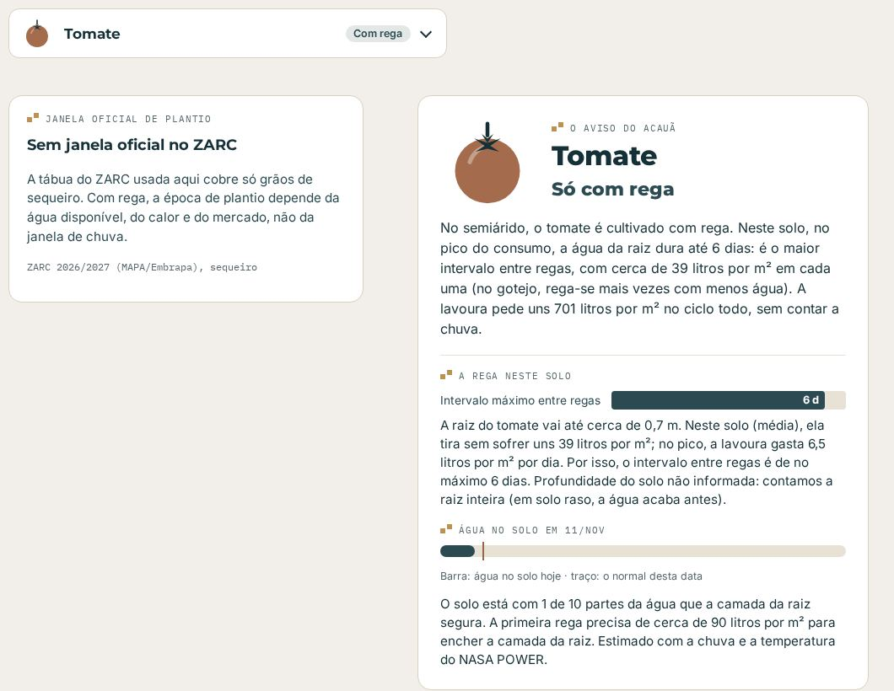
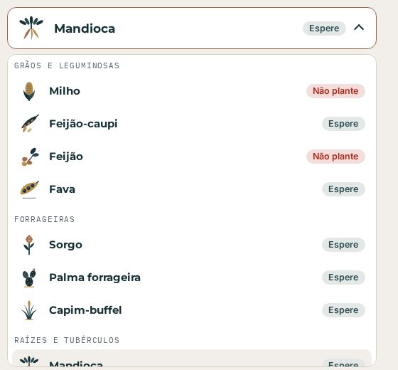
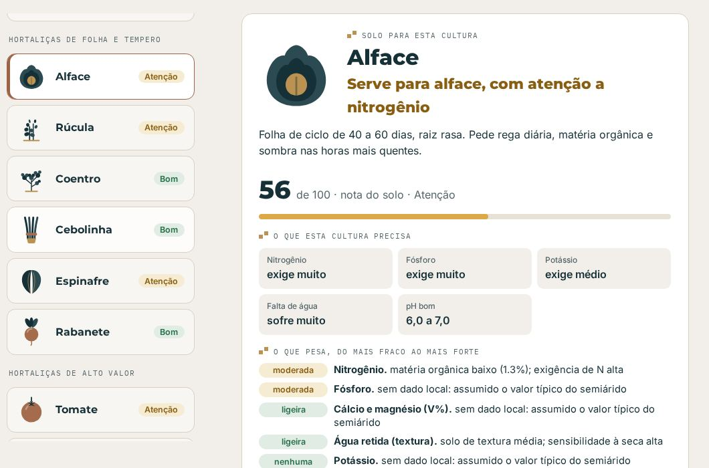
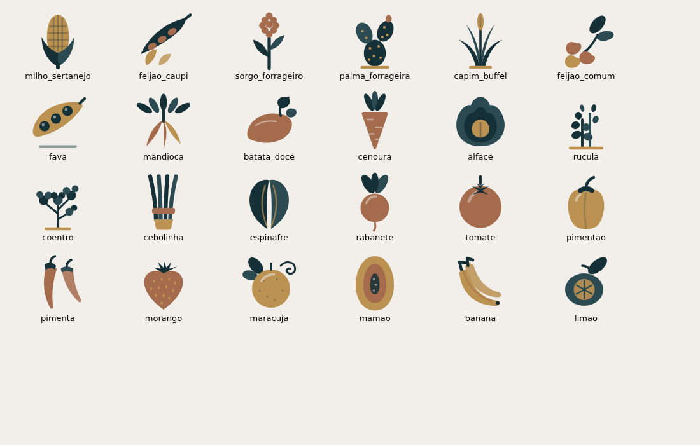

# Feature 8 — Culturas do agricultor familiar

**Status:** implementada na branch `feature/novas-culturas` (a partir da `feature/agua-e-insights`).
Validada com testes e com cliques reais em navegador, cultura por cultura, na Plantio e na Início.
**Data:** 15/11/2026

## O que entrou

O app tinha 5 culturas, todas de sequeiro: milho, feijão-caupi, sorgo, palma e capim-buffel. Agora tem 24, em
6 grupos:

| Grupo | Culturas novas | Manejo no semiárido |
|---|---|---|
| Grãos e leguminosas | **feijão** (comum), **fava** (milho e caupi já existiam) | sequeiro |
| Raízes e tubérculos | **mandioca**, **batata-doce** | sequeiro |
| | **cenoura** | com rega |
| Hortaliças de folha e tempero | **alface, rúcula, coentro, cebolinha, espinafre, rabanete** | com rega |
| Hortaliças de alto valor | **tomate, pimentão, pimenta, morango** | com rega |
| Frutas | **maracujá, mamão, banana, limão taiti** | com rega |

### Decisão: o manejo muda o aviso

- **Sequeiro.** O aviso continua como antes: ZARC, chuva firme, janela e risco de quebra de safra no Monte
  Carlo. Também mostra os dias que a terra segura a lavoura contra o veranico típico.
- **Com rega.** No semiárido, hortaliça e fruta não se planta contando com a chuva, então o risco de quebra
  pela chuva não se aplica. O aviso vira **"Só com rega"** e mostra o **plano de rega neste solo**:
  - **Intervalo máximo entre regas:** RAW / ETc no pico do consumo, o turno de rega da FAO-56.
  - **Litros por m² em cada rega.**
  - **Água do ciclo:** ou do ano, nas perenes, pela soma de Kc x ET0 normal a partir de hoje, sem contar a
    chuva.
  - **Primeira rega:** quanto ela precisa para encher a camada da raiz, pela água no solo hoje.
- O gráfico "Se a chuva atrasar" só aparece nas culturas de sequeiro.

## Validação: cada cultura em cada ponto de dado

`domain/crop_registry.py` (`check_connections`) confere cada cultura em cada fonte que as telas usam. O teste
`tests/test_culturas_conectadas.py` falha se faltar qualquer ligação obrigatória. "—" = não se aplica.

| Cultura | Manejo | registro | nome | solo | bases | descricao | agua | icone | motor | chuva_ciclo | zarc |
|---|---|---|---|---|---|---|---|---|---|---|---|
| Milho | sequeiro | sim | sim | sim | sim | sim | sim | sim | sim | sim | sim |
| Feijão-caupi | sequeiro | sim | sim | sim | sim | sim | sim | sim | sim | sim | sim |
| Feijão | sequeiro | sim | sim | sim | sim | sim | sim | sim | sim | sim | sim |
| Fava | sequeiro | sim | sim | sim | sim | sim | sim | sim | sim | sim | — |
| Sorgo | sequeiro | sim | sim | sim | sim | sim | sim | sim | sim | sim | sim |
| Palma forrageira | sequeiro | sim | sim | sim | sim | sim | sim | sim | sim | sim | — |
| Capim-buffel | sequeiro | sim | sim | sim | sim | sim | sim | sim | sim | sim | — |
| Mandioca | sequeiro | sim | sim | sim | sim | sim | sim | sim | sim | sim | — |
| Batata-doce | sequeiro | sim | sim | sim | sim | sim | sim | sim | sim | sim | — |
| Cenoura | com rega | sim | sim | sim | sim | sim | sim | sim | — | — | — |
| Alface | com rega | sim | sim | sim | sim | sim | sim | sim | — | — | — |
| Rúcula | com rega | sim | sim | sim | sim | sim | sim | sim | — | — | — |
| Coentro | com rega | sim | sim | sim | sim | sim | sim | sim | — | — | — |
| Cebolinha | com rega | sim | sim | sim | sim | sim | sim | sim | — | — | — |
| Espinafre | com rega | sim | sim | sim | sim | sim | sim | sim | — | — | — |
| Rabanete | com rega | sim | sim | sim | sim | sim | sim | sim | — | — | — |
| Tomate | com rega | sim | sim | sim | sim | sim | sim | sim | — | — | — |
| Pimentão | com rega | sim | sim | sim | sim | sim | sim | sim | — | — | — |
| Pimenta | com rega | sim | sim | sim | sim | sim | sim | sim | — | — | — |
| Morango | com rega | sim | sim | sim | sim | sim | sim | sim | — | — | — |
| Maracujá | com rega | sim | sim | sim | sim | sim | sim | sim | — | — | — |
| Mamão | com rega | sim | sim | sim | sim | sim | sim | sim | — | — | — |
| Banana | com rega | sim | sim | sim | sim | sim | sim | sim | — | — | — |
| Limão taiti | com rega | sim | sim | sim | sim | sim | sim | sim | — | — | — |

| Ponto | Onde | Usado em |
|---|---|---|
| registro | `config/culturas.yaml` | grupo, manejo, perene, leguminosa, nome feminino |
| nome, solo, bases, descricao | `config/aptidao.yaml` | Início: solo por cultura (nota, fatores, texto) |
| agua | `config/agua.yaml` (Kc, raiz, p, fases da FAO-56) | dias que aguenta; plano de rega; água no solo hoje |
| icone | `app/icons.py` | seletor da Plantio e cards da Início |
| motor | `domain/presets.py` (CropSpec) | risco de quebra de safra (Monte Carlo), só sequeiro |
| chuva_ciclo | `config/culturas.yaml` | régua de falta de água do motor, só sequeiro |
| zarc | `config/zarc.yaml` | janela oficial, só onde a tábua tem a cultura |

**Navegador:** as 24 culturas foram selecionadas uma a uma no seletor da Plantio e nos cards da Início
(Petrolina, 15/11/2026). Todas mostram aviso, bloco de água e nota do solo, sem erro na tela nem no
JavaScript.

## O que muda no motor

- **Chuva do ciclo:** a régua de falta de água saiu do código (`430 se milho, senão 270 ou 160`) e foi para
  `config/culturas.yaml`. As 5 culturas antigas mantêm os mesmos números; um teste garante isso.
- **Leguminosas:** feijão e fava usam a mesma matriz de solo do caupi, que fixa nitrogênio. A marcação fica no
  registro.
- **Matriz do aviso:** cobre todas as culturas de sequeiro do registro (eram 5 fixas no código).
- **CropSpec das 4 novas de sequeiro:** produtividade, preço e custo ficam zerados de propósito. Não há fonte,
  e o aviso só usa a colheita relativa. Elas não entram em nenhuma rotação do ranking.

## Telas

| Aviso de cultura com rega (tomate) | Seletor por grupo |
|---|---|
|  |  |

| Solo por cultura (Início) | Ícones |
|---|---|
|  |  |

## Limitações

- **Parâmetros de memória.** pH (FAO Ecocrop), Kc, raiz e p (FAO-56), exigências de N, P e K e chuva do ciclo
  foram escritos de memória, todos com `# CONFERIR` ou `# REVISAR AGRÔNOMO`.
  - Rúcula, coentro, pimenta, fava, maracujá e mamão usam análogos ou valores sem tabela da FAO.
- **ZARC.** A tábua de dados abertos só traz grãos anuais. O ZARC de mandioca e de frutas sai em portarias
  à parte, que não estão no app.
  - O feijão comum usa "Feijão" (1ª safra), que não é indicado em sequeiro nos 4 municípios de exemplo.
  - Fica para revisão se "Feijão 2ª Safra" é o certo para o plantio das águas no semiárido.
- **Estrutura.** Estufa e sombrite (morango, tomate) não entram no cálculo.
  - O morango no semiárido só vai em altitude ou com estrutura, e o texto diz isso.
- **O plano de rega não desconta a chuva.** O intervalo é o máximo da FAO-56; no gotejo se rega mais vezes,
  com menos água.
- **Rotações e renda.** Nenhuma rotação do ranking usa as culturas novas. Montar rotações e consórcios com
  elas (milho + feijão + fava, por exemplo) e a renda por m² das hortaliças pedem preços com fonte (CONAB ou
  CEASA).
