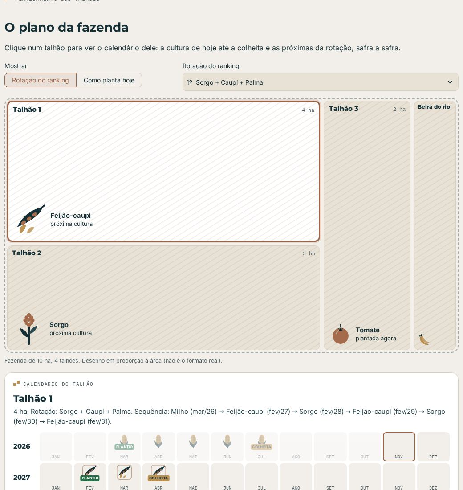
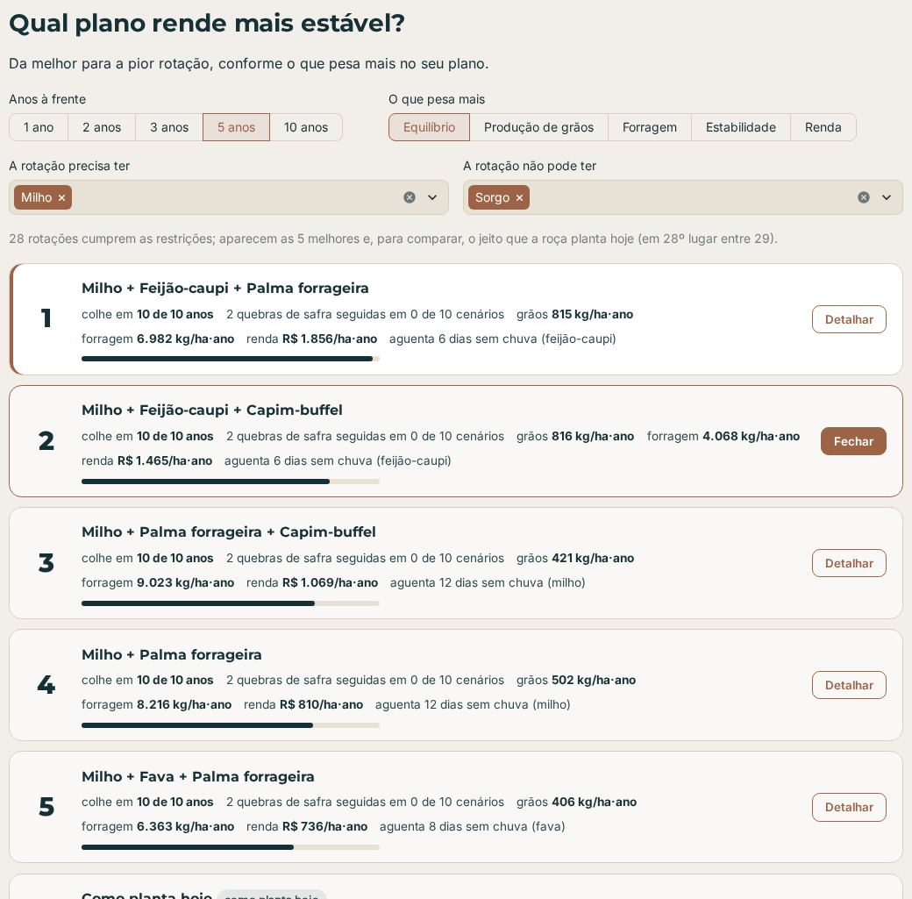
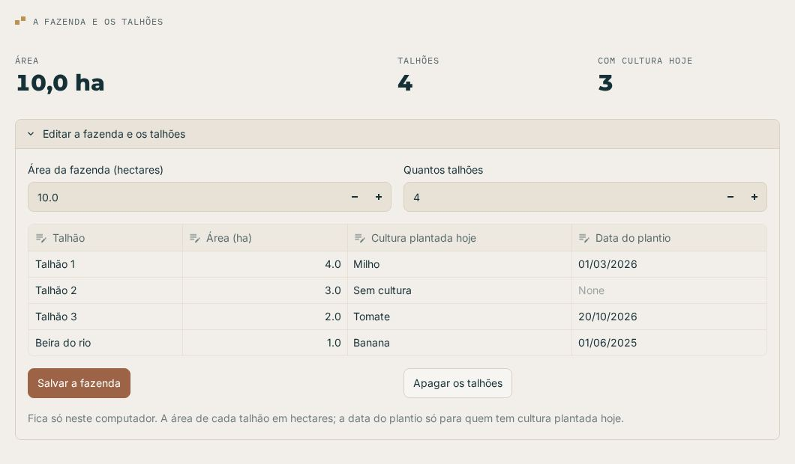
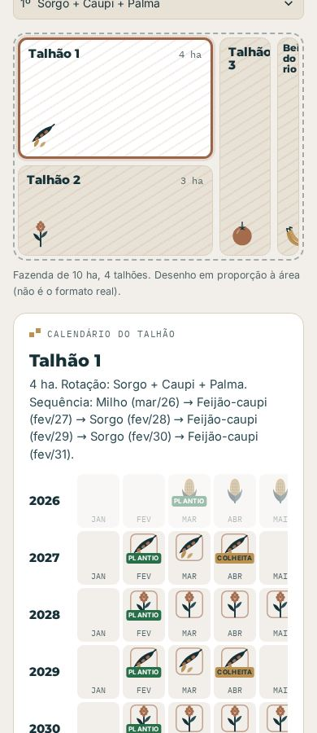

# Feature 10 — Talhões e o plano de rotação da fazenda

**Status:** implementada na branch `feature/talhoes` (a partir da `feature/novas-culturas`, já com a `main`).
Verificada com testes e com cliques reais em navegador.
**Data:** 15/11/2026

## O que o produtor faz agora

1. **Na Início, em "A fazenda e os talhões":** informa a área da fazenda e quantos talhões ela tem. Numa
   tabela, dá a cada talhão um nome, a área em hectares e, se houver, a cultura plantada hoje e a data do
   plantio.
   - O app avisa se a soma dos talhões passa da área da fazenda.
   - Não deixa salvar talhão sem área, cultura sem data ou data no futuro.
   - Talhão sem área recebe a parte que sobra da fazenda, dividida por igual.
2. **Na Plantio, no ranking, escolhe as restrições:** "a rotação precisa ter" (ex.: milho) e "não pode ter"
   (ex.: sorgo). O ranking inteiro é refeito em volta disso.
3. **Na Plantio, em "O plano da fazenda", vê o quadro com os talhões** desenhados em proporção à área. Cada
   talhão mostra o ícone da cultura de agora ou da próxima. Clicar num talhão abre o **calendário** dele.
4. **No calendário,** o ícone da cultura aparece em todos os meses, do plantio à colheita, com as marcas
   "plantio" e "colheita". Depois vem o ícone da próxima cultura, safra a safra, até o fim do horizonte. Dá
   para alternar entre **"Rotação do ranking"** (a escolhida na lista ou a do "Detalhar") e **"Como planta
   hoje"**.
5. **O plano completo** de todos os talhões fica num resumo e num **CSV para baixar**.

## Como funciona

### Ranking em volta das restrições (`engine/candidates.py`)
- **Candidatas:** o motor recebe **todas as combinações de 1 a 3 culturas de sequeiro** (129 com as 9 de
  hoje) que contêm as culturas exigidas e nenhuma das proibidas. Antes eram 4 rotações fixas.
- **Nomes:** quando a combinação é igual a uma rotação de exemplo, ela mantém o nome (ex.: "Milho + Caupi").
- **O que aparece:** as **5 melhores** pela prioridade escolhida. A rotação **"Como planta hoje"** sempre
  aparece para comparar, com a posição dela entre todas, como pede o desafio.
  - Ela é feita das culturas de sequeiro plantadas hoje nos talhões.
  - Sem talhões, ela é o milho todo ano.
- **Tempo:** cada rotação roda 10.000 cenários e fica no cache **sozinha**. Mudar a restrição só escolhe
  outras do cache. Na primeira vez são cerca de 3,5 s para as 129, no horizonte de 5 anos.
- **Memória:** o cache guarda 1.000 cenários por rotação para os gráficos. As notas usam os 10.000.
- **Culturas com rega** não entram nas restrições, porque não dependem da chuva que o motor simula. Elas
  aparecem nos talhões como cultura plantada hoje.

### Calendário de cada talhão (`analytics/talhoes.py`)
- **Datas:**
  - Plantio de sequeiro no dia em que a chuva costuma firmar: mediana de 1991-2020 do critério de Sivakumar,
    a mesma referência do atraso da chuva.
  - Colheita pelo ciclo da cultura: soma das fases da FAO-56, ou `ciclo_dias` do registro (mandioca:
    365 dias, REVISAR AGRÔNOMO).
- **A cultura de hoje** fica até a colheita. Se já foi colhida neste ano, ainda aparece nos meses passados.
  Cultura **perene** plantada (banana, palma...) **fica no talhão** nos dois modos.
- **"Como planta hoje":**
  - cada talhão repete a cultura dele;
  - sequeiro uma vez por safra;
  - com rega, replanta uma semana depois da colheita;
  - talhão sem cultura fica vazio.
- **"Rotação do ranking":**
  - as perenes da rotação (palma, buffel, mandioca) vão para os talhões livres **menores**;
  - as anuais **giram** entre os outros talhões, uma posição por safra (talhão j planta `anuais[(j + safra)
    mod n]`), o que alterna leguminosa e cereal no mesmo chão;
  - rotação só de perenes: elas se repartem entre os talhões.
- **Quadro:** retângulos com área proporcional à de cada talhão (o formato real não é conhecido). A área da
  fazenda que sobra fora dos talhões aparece como "Sem talhão".

### Onde ficam os dados
`data/fazenda/<local>.json`, só neste computador (data/ é ignorado no git), como a análise de campo.

## Limitações

- **Áreas.** A simulação do ranking divide a área **igualmente** entre as culturas da rotação. No plano, elas
  vão para talhões de tamanhos diferentes. A tela avisa.
- **Uma safra por ano.** O plano não encaixa uma segunda cultura de sequeiro no mesmo ano (safrinha) nem
  consórcio no mesmo talhão.
- **Escolha automática.** A posição das perenes (talhões menores) e a ordem da rotação são automáticas. O
  produtor ainda não escolhe qual talhão recebe o quê.
- **Rotações de até 3 culturas** (mais, se as exigências pedirem).
- **A data de plantio é a mediana.** O aviso do ano (chuva firmou ou não) continua na seção de cima.
- **Teste da tabela no navegador.** O cadastro foi testado na tela (área, número de talhões, datas, salvar,
  avisos). A tabela é desenhada em canvas, e parte das escolhas de cultura no teste automático foi completada
  direto no arquivo.

## Arquivos

| Arquivo | Mudança |
|---|---|
| `src/crop_optimizer/domain/fazenda.py` | novo: fazenda, talhões, validação, salvar/ler |
| `src/crop_optimizer/engine/candidates.py` | novo: rotações candidatas pelas restrições; "como planta hoje" |
| `src/crop_optimizer/analytics/talhoes.py` | novo: safras, distribuição nos talhões, calendário, plano em tabela, desenho proporcional |
| `src/crop_optimizer/app/home_page.py` | cadastro da fazenda e dos talhões |
| `src/crop_optimizer/app/dashboard.py` | restrições no ranking; simulação por rotação com cache; seção "O plano da fazenda" |
| `src/crop_optimizer/app/components.py` | quadro da fazenda e calendário do talhão |
| `config/culturas.yaml` | `ciclo_dias` (mandioca) |
| `tests/test_talhoes.py` | 14 testes novos |
| `docs/features/09-novas-culturas.md` | renumerado (a `main` já tinha um 08, o do calendário de chuva) |

## Telas

| O plano da fazenda | Restrições no ranking |
|---|---|
|  |  |

| Cadastro na Início | No celular |
|---|---|
|  |  |
